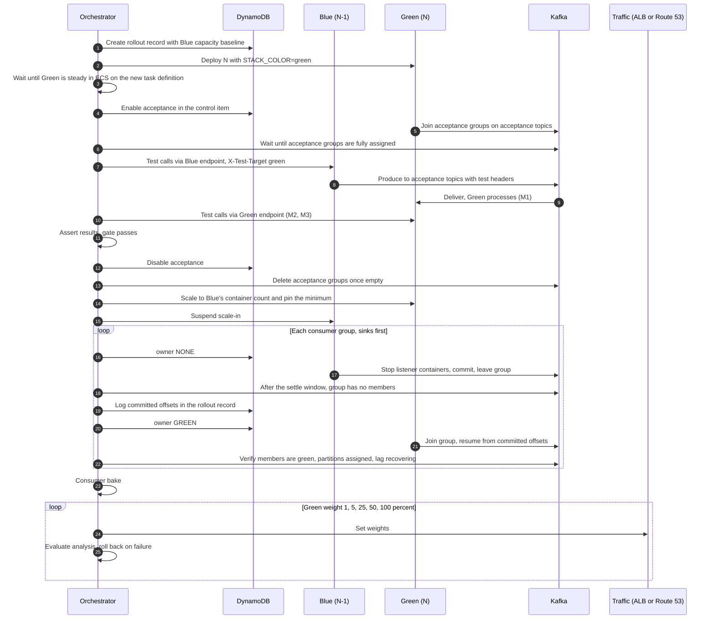
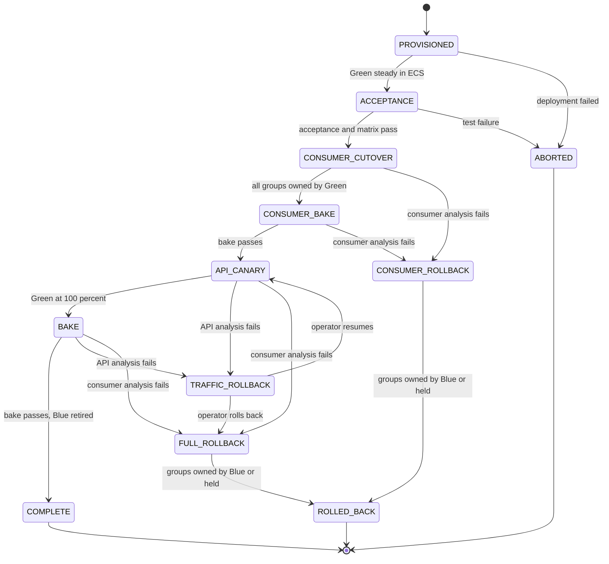
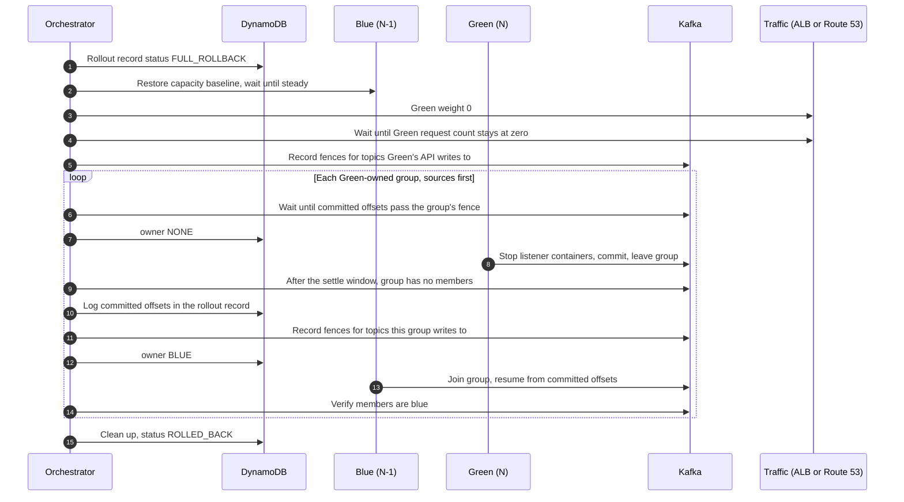

# Blue-Green and Canary Deployment Strategy for Spring Boot APIs and Kafka Consumers

> **Status:** Proposal for review
> **Scope:** Application 1 (APIs only) and Application 2 (APIs + Kafka consumers), all regions and stacks
> **Date:** October 2026

---

## Contents

1. [Executive summary](#1-executive-summary)
2. [Context, terminology and invariants](#2-context-terminology-and-invariants)
3. [Kafka mechanics that shape the design](#3-kafka-mechanics-that-shape-the-design)
4. [Analysis of the provided strategy](#4-analysis-of-the-provided-strategy)
5. [Alternative strategies](#5-alternative-strategies)
6. [Comparison and functional requirements](#6-comparison-and-functional-requirements)
7. [Recommended approach and test design](#7-recommended-approach-and-test-design)
8. [Synchronizing the API canary with the consumer switchover](#8-synchronizing-the-api-canary-with-the-consumer-switchover)
9. [Rollback strategy and mechanisms](#9-rollback-strategy-and-mechanisms)
10. [Container lifecycle and scaling](#10-container-lifecycle-and-scaling)
11. [Observability, automated gates and rollback triggers](#11-observability-automated-gates-and-rollback-triggers)
12. [Adoption roadmap](#12-adoption-roadmap)
- [Appendix A — Naming conventions](#appendix-a--naming-conventions)
- [Appendix B — Verification snippets](#appendix-b--verification-snippets)

---

## 1. Executive summary

The provided strategy (color-aware consumers, acceptance topic first, dynamic flip, then an API ramp) has the right shape and is the base of the recommended design. It gets the most important ordering right: **consumers move to the new build before producers do**, so rolling forward needs only *backward* compatibility.

Four changes make it production-safe:

1. **Group identity.** Functional consumer groups keep the **same `group.id` on both colors**. A flip is then a partition handover with continuous offsets. A color-specific group id would start from `auto.offset.reset` and either skip the backlog or replay the whole retention window.
2. **Flip sequencing.** "Simultaneously" is a race between independent pollers. Replace it with a versioned control item in DynamoDB and a per-group **drain → verify → start** handover, verified against Kafka's own view of group membership.
3. **Acceptance isolation.** Acceptance subscriptions run in **per-rollout consumer groups** on dedicated acceptance topics, never in functional groups. Test records name the color that should consume them, so neither color processes them twice.
4. **Old-stack test routing.** The old-producer → new-consumer test only works if the *old* (N-1) build can route tagged test requests to acceptance topics. That capability ships in an enabling release before the first rollout that relies on it.

**Rollout.** Consumer groups move to Green one at a time, downstream groups before upstream ones; high-risk groups can get a partition-level canary first. After a consumer bake, API traffic ramps to Green. ALB weighted target groups are the recommended traffic control because they shift, and roll back, per request. Route 53 weighting also works, but a rollback through it takes effect only as DNS caches and keep-alive connections expire.

**Rollback.** Rollback is three separate operations: move API traffic back, hand consumer groups back, and repair what N already wrote.

- The first two are reversible configuration changes. Handing a group back needs no offset manipulation, because both colors share the group's committed offsets.
- A group can be handed back once every unconsumed record in its input topics is readable by the old build. When N has already produced records the old build may not read, Green keeps the group until it has consumed past an **input fence**, unless forward compatibility has been proven.
- Data N already wrote can only be repaired, not rolled back. The orchestrator's rollout record logs exactly which offsets Green processed, and every record carries a message id and producer build, so repair can be scoped precisely.
- Once Blue is retired, rollback means rolling N-1 out again as a new candidate.

**Requirements.** Every strategy needs idempotent consumers, message-id and build headers, transitive backward compatibility, expand/contract database migrations, a side-effect repair plan, a dead-letter topic with replay, per-color metrics and graceful shutdown. The recommended strategy adds a configuration reconciler in each container and an orchestrator that verifies against Kafka and ECS. Section 6 lists what each alternative adds, and section 7.6 lists mechanisms this design deliberately does not require.

**Alternatives.** Partition canary (A) and shadow consumption (B) extend the recommended control plane for high-risk groups and releases. Cohort routing (C) is not justified by these requirements. Versioned topics (D) are reserved for breaking schema changes.

**Containers.** Containers start and stop at any point of a rollout. The design stays correct because:

- every container derives its role from the control item and its color at runtime;
- Kafka membership is verified after a settle window;
- only the pipeline can change a color's service;
- the orchestrator sets capacity floors and scaling suspensions for both colors in every phase.

---

## 2. Context, terminology and invariants

### 2.1 Context

| Aspect | Current state |
|---|---|
| Applications | App 1: APIs only. App 2: APIs + Kafka consumers in the same process. Both run in containers on ECS. |
| Topology | Multiple regions; multiple stacks per region. |
| Static config | Spring profiles per region and per stack. |
| Consumer config | Loaded dynamically from DynamoDB; multiple consumer groups per container, multiple topics per group. |
| API canary | Load balancers + Route 53 weighting. |
| Testing | Acceptance suite on new deployments; a dedicated acceptance-test topic. |
| Hard requirement | Messages produced by the old stack must be processed correctly by the new stack, and all acceptance tests must pass, before full rollout. |

### 2.2 Terms

| Term | Meaning |
|---|---|
| **Stack** | One deployment of an application in a region, with its own config profile. A region can have several. Every stack has two colors. |
| **Color** | Blue or Green: one of a stack's two side-by-side copies, each its own ECS service. This document calls the live color Blue and the candidate Green; the roles swap every rollout. |
| **Live / Candidate** | The role a color currently plays. The orchestrator tracks roles; containers never need to know them. |
| **N-1 / N** | The build currently live / the build being rolled out. |
| **N-format record** | A record written by N code: Green's API or a Green-owned consumer group. Before forward compatibility is proven, N-1 may not be able to read it. |
| **Rollout** | One run of the pipeline, taking a candidate from provisioning to live (phases P0–P5, section 8.2). Identified by a deployment id. |
| **Container** | One running copy of an application: an ECS task. |
| **Listener container** | A Spring Kafka `MessageListenerContainer`. A container runs one listener container per consumer group it currently consumes. |
| **Functional topics / groups** | Production topics and the consumer groups that process them. |
| **Acceptance topics / groups** | Test-only topics and the per-rollout groups that consume them. |
| **Control item** | The DynamoDB item, read by every container, declaring which color owns each functional group and whether acceptance listeners run. |
| **Rollout record** | The DynamoDB item, written and read only by the orchestrator, holding a rollout's phase, capacity baseline, handover log and fences. |
| **Orchestrator** | The deployment pipeline (for example a Step Functions state machine). The only writer of the control item, the rollout record and traffic weights. |
| **Handover / handback** | Moving ownership of a functional group from Blue to Green / from Green back to Blue. |
| **Input fence** | Per-partition offsets that Green must consume past before a group can be handed back (section 9.4). |

### 2.3 Design invariants

These are non-negotiable; every mechanism in this document exists to enforce one of them.

| # | Invariant |
|---|---|
| I1 | A functional consumer group has members from **at most one color**, except during an overlap the orchestrator explicitly declares. |
| I2 | Functional group ids, topics and serialization config are **identical on both colors**. Color changes identity (client ids, metric tags), never configuration. |
| I3 | Synthetic test records never enter functional topics; functional records never enter acceptance groups. |
| I4 | Green's API receives production traffic only after Green owns every functional group that consumes the topics Green's API writes to, or forward compatibility has been proven. |
| I5 | Blue owns a functional group only when every record after the group's committed offsets is readable by Blue: written by Blue code, or covered by proven forward compatibility. |
| I6 | Every consumer is idempotent under redelivery. |
| I7 | Database schema changes in N are expand-only. Contract steps ship in a later release, after N is past the point of no return. |
| I8 | Rollout state changes only through the orchestrator. Humans act through the orchestrator, not by editing DynamoDB, weights or services directly. |
| I9 | A container's role is derived at runtime from the control item and its color. During a rollout each color's service runs exactly one task definition, which only the orchestrator can change. |
| I10 | During a rollout, the orchestrator sets capacity floors and scaling suspensions for both colors; autoscaling operates inside them. |

---

## 3. Kafka mechanics that shape the design

| Mechanic | Consequence for blue-green |
|---|---|
| Committed offsets are keyed by `(group.id, topic, partition)`. | Same group id on both colors → the new owner resumes exactly where the old one committed, in both directions. A new group id starts at `auto.offset.reset`: `latest` silently skips the backlog, `earliest` replays the whole retention window. |
| Every consumer group receives every record. | Two colors in two different groups on the same functional topic means every record is processed twice. |
| `pause()` keeps partition ownership; `stop()` leaves the group. | Paused consumers still hold their partitions, so the other color never receives them. A handover must **stop** the listener containers. |
| Rebalance protocol. | Classic eager: every member stops on any join or leave. Classic cooperative (`CooperativeStickyAssignor`): only moved partitions pause. KIP-848 (`group.protocol=consumer`, GA in Apache Kafka 4.0, supported on MSK 4.x): broker-side incremental assignment; client-side assignors are not supported and the session timeout becomes a broker setting. Prefer incremental rebalancing. |
| Members of a classic group must share an assignor during an overlap. | If Blue uses only `RangeAssignor` and Green only `CooperativeStickyAssignor`, they can't be in the same group at the same time. Change assignors with the documented two-step rolling procedure, never in the same release as an overlap. |
| Handover is at-least-once. | Records processed but not committed when a partition is revoked are redelivered to the new owner. Commit on revocation and make processing idempotent; don't try to make the flip exactly-once. |
| Offsets can be changed only on an empty group. | `Admin.alterConsumerGroupOffsets` and `kafka-consumer-groups --reset-offsets` reject groups with active members, and report rejections per partition. Deliberate reprocessing therefore fits only in the empty window of a handback. |
| Offsets of an empty group expire. | `offsets.retention.minutes` (7 days by default) starts counting when a group becomes empty. This matters for per-rollout groups that are never deleted and for groups held empty during a rollback. |
| Compatibility has a direction. | **BACKWARD** (Confluent's default; new reader, old data) → upgrade consumers before producers. **FORWARD** (old reader, new data) → required for N-1 to read N's records after a rollback. **FULL** → both. `_TRANSITIVE` variants check every earlier version, not only the last. |
| Data at rest is old. | Retention, consumer lag and DLT replays mean N reads data written by N-1, N-2 and earlier. Backward compatibility must be **transitive**. |

Three rules follow from this table and drive the rest of the document:

- **Forward: consumers before producers, sinks before sources.** A build that emits a new message shape must only emit to consumers that already run a build that understands it. This holds between the API and consumers, between chained consumer groups, and between applications.
- **Rollback runs the other way: traffic first, then sources before sinks.** Each group is handed back only once its unread input is readable by the old build (I5).
- **One group id, one owner at a time.** Offsets stay continuous only when both colors share the functional group id and every change of owner is explicit.

---

## 4. Analysis of the provided strategy

Section 4.1 assesses each step as written. Section 4.2 describes the implementation with the hardening applied. Its rollback is covered in section 9, and its behavior under container churn in section 10.

### 4.1 Step-by-step assessment

| Step | Assessment | Gap | Hardening |
|---|---|---|---|
| **1. Stack-aware (color-aware) application** | Necessary. | Colors alternate; any logic that assumes "Green = new" breaks on the next release. Making color a Spring profile invites config drift between colors. | Inject color as an environment variable and use it only for client identity and for evaluating the control item. |
| **2. New stack subscribes only to the test topic** | The correct gate: no production record reaches N before tests pass. | Which consumer group? If acceptance subscriptions share the functional group id, test records split across colors. A single shared test topic also means Green's acceptance wiring differs from its functional wiring. | Per-rollout acceptance groups. One acceptance topic per functional topic the suite covers. Same message handlers and listener container factory as the functional path. |
| **3. Acceptance tests + old-stack traffic** | The key backward-compatibility check, run against the real N-1 binary. | Blue's API produces to *functional* topics unless N-1 already knows how to route test requests elsewhere. Sending "a percentage of test traffic" through weighted routing also mixes it with real users. | A test-routing contract shipped in N-1; the test harness calls per-color endpoints directly; records name the color that should consume them. |
| **4. Dynamic flip** | The right mechanism: config-driven, fast, reversible. | "Simultaneously" is a race between independent pollers, so you get overlap or a gap depending on timing. Flipping all groups at once is a 0→100% jump for consumers. Nothing verifies that the old color actually left the groups. | Versioned control item; per-group drain → verify (Kafka AdminClient) → start; groups ordered sinks first; optional overlap as a partition canary. |
| **5. Route 53 ramp** | Correct ordering: consumers first. | No rollback is defined. Handing consumers back after Green's API has produced records requires Blue to read N's records (forward compatibility), which the plan doesn't test. DNS weighting is approximate and slow to reverse. | The rollback design in section 9 (input fence, or forward compatibility proven by schema rules and the M3 test). Per-request traffic control through ALB weighted target groups (section 8.1). |

### 4.2 Practical implementation

#### 4.2.1 Container identity

The pipeline sets three environment variables in each color's task definition. Both colors run the **same artifact with the same profiles**; color is not a profile.

```yaml
deployment:
  color: ${STACK_COLOR}                 # blue | green
  deployment-id: ${DEPLOYMENT_ID}       # the rollout's id; names this rollout's acceptance groups only
  stack-id: ${STACK_ID}                 # e.g. prod#ap-south-1#stack-a
  control:
    table: ${CONSUMER_CONFIG_TABLE}
    poll-interval-ms: 5000

spring:
  kafka:
    client-id: orders-${deployment.color}            # Spring appends -n per consumer thread
    consumer:
      max-poll-records: 100                          # bounds drain time on stop
      properties:
        partition.assignment.strategy: org.apache.kafka.clients.consumer.CooperativeStickyAssignor

management:
  metrics:
    tags:
      color: ${deployment.color}
      build: ${info.build.version:unknown}           # from Spring Boot build info
```

Color appears only in client identity and metric tags:

- `client.id` includes color, so the orchestrator can tell the colors apart in Kafka's membership view.
- If you use static membership, `group.instance.id` must include color; shared ids across colors cause partition stealing. Section 10.8 explains why static membership is better avoided on groups that change owner.
- If you use Kafka transactions, the `transactional.id` prefix must be unique per container: include color and the task id. Shared ids make producers fence each other.

#### 4.2.2 DynamoDB data model

The existing consumer-config table gains two items per stack: a control item that containers read, and a rollout record per rollout that only the orchestrator reads and writes. Adapt key shapes to your current schema; the semantics are what matter.

**Consumer config item** (existing, lightly extended):

```json
{
  "pk": "STACK#prod#ap-south-1#stack-a",
  "sk": "CONSUMER#order-events",
  "groupId": "orders.order-events",
  "topics": ["orders.created", "orders.updated"],
  "concurrency": 6,
  "enabled": true,
  "risk": "high"
}
```

`risk: high` marks groups that get a partition-canary step during cutover (section 7.1).

**Control item** (new; read by every container):

```json
{
  "pk": "STACK#prod#ap-south-1#stack-a",
  "sk": "CONTROL",
  "rev": 118,
  "defaultOwner": "BLUE",
  "ownership": {
    "audit-events":   { "owner": "GREEN" },
    "payment-events": { "owner": "NONE" },
    "order-events":   { "owner": "BOTH", "concurrency": { "GREEN": 1 } }
  },
  "acceptance": { "BLUE": false, "GREEN": true },
  "updatedBy": "pipeline/run-8812",
  "updatedAt": "2026-10-26T06:10:00Z"
}
```

| `owner` value | Meaning |
|---|---|
| `BLUE` / `GREEN` | Only that color runs functional listener containers for the group. |
| `NONE` | Nobody consumes: the drain step of a handover or handback, or a held group (section 9.5). |
| `BOTH` | Both colors run functional listener containers in the **same** group: a partition canary or make-before-break overlap. Optional per-color concurrency. |

A consumer without an entry in `ownership` is owned by `defaultOwner`, the live color. Between rollouts the control item holds only `defaultOwner` and an empty `ownership` map; newly added consumer configs therefore always have a defined owner. If no control item exists (before the first rollout), containers run every functional listener, as they do today.

**Rollout record** (new; orchestrator only):

```json
{
  "pk": "ROLLOUT#prod#ap-south-1#stack-a",
  "sk": "d-20261026-7f3c",
  "version": 42,
  "status": "IN_PROGRESS",
  "phase": "CONSUMER_CUTOVER",
  "live":      { "color": "BLUE",  "build": "4.12.0", "taskDefinition": "orders-blue:56" },
  "candidate": { "color": "GREEN", "build": "4.13.0", "taskDefinition": "orders-green:57" },
  "capacityBaseline": { "BLUE": { "desired": 12, "min": 8, "max": 40 } },
  "handovers": [
    { "group": "orders.audit-events", "to": "GREEN", "at": "2026-10-26T06:02:11Z",
      "committedOffsets": { "audit.events-0": 88123, "audit.events-1": 87990 } }
  ],
  "fences": [],
  "heldGroups": [],
  "updatedAt": "2026-10-26T06:10:00Z"
}
```

The handover log records each group's committed offsets at the moment ownership changes. Together with the matching handback entry it gives the exact per-partition range of records Green processed, which is what data repair needs (section 9.6). Its partition key differs from the stack's, so containers never read it.

Rules for the model:

- **Conditional writes.** The orchestrator writes the control item with `ConditionExpression: rev = :expected` and increments `rev`; the rollout record uses `version` the same way. Two pipelines can never interleave.
- **Region-local writes.** If the table is a global table, key items by region and write them only in their own region. Global-table replication is asynchronous with last-writer-wins, so a cross-region write race could silently revert a flip.
- **Single derivation.** Each container's desired state is a pure function of (control item, consumer config items, its own color). Nothing else.
- **Containers never write.** Whether a handover finished is read from Kafka membership; whether a color's containers are up is read from ECS; control-plane health comes from metrics each container publishes (section 4.2.3).

#### 4.2.3 Propagating changes

- **Poll as the source of truth.** Each container queries its stack partition with `ConsistentRead=true` every 5 s. The cost is negligible (200 containers × 12 small reads/min).
- **Push is optional.** DynamoDB Streams can nudge containers to poll early, but correctness must never depend on it.
- **Fail static.** If DynamoDB is unreachable, keep whatever is running and emit a metric. Never start or stop listener containers on a failed read.
- **Fail closed at startup.** A new container starts no functional listener container until its first successful read, taken after a small random delay so a mass restart doesn't burst DynamoDB. This is also why ownership lives in DynamoDB rather than in environment variables: a container launched by autoscaling in the middle of a flip reads the current state and lands in the right place.
- **Report through metrics.** Each container publishes control-plane read failures and the `rev` it last applied, tagged by color. The orchestrator uses them as a precondition for each step; Kafka membership remains the authoritative check.

#### 4.2.4 Reconciler in Spring Boot

Because consumer configs are dynamic, listener containers are created programmatically from the existing `ConcurrentKafkaListenerContainerFactory`, so error handlers, ack modes and deserializers are identical on the functional and acceptance paths. (If some listeners are declared with `@KafkaListener`, give them ids and `autoStartup = "false"` and drive them through `KafkaListenerEndpointRegistry` the same way.)

```java
@Component
@RequiredArgsConstructor
class ConsumerReconciler {

    private final StackIdentity me;                     // color, deployment id, service name (from env)
    private final ControlPlaneClient controlPlane;      // DynamoDB query with ConsistentRead
    private final ListenerContainerManager listeners;
    private final ReconcilerMetrics metrics;            // read failures, applied rev (tagged by color)

    // First run after a small random delay; then every poll interval.
    @Scheduled(fixedDelayString = "${deployment.control.poll-interval-ms:5000}")
    void reconcile() {
        Snapshot snap;
        try {
            snap = controlPlane.read();
        } catch (Exception e) {
            metrics.readFailed(e);                      // fail static: change nothing
            return;
        }
        listeners.converge(DesiredState.compute(snap, me));   // idempotent, self-healing
        metrics.appliedRev(snap.rev());
    }
}
```

```java
final class DesiredState {

    static Map<String, ListenerSpec> compute(Snapshot s, StackIdentity me) {
        Map<String, ListenerSpec> out = new LinkedHashMap<>();
        for (ConsumerConfig c : s.consumers()) {
            if (!c.enabled()) continue;
            // Explicit ownership entry, else defaultOwner; every color if no control item exists yet.
            Ownership o = s.ownership(c.name());
            if (o.includes(me.color())) {
                out.put(c.name() + ":FUNCTIONAL",
                        ListenerSpec.functional(c, me, o.concurrencyFor(me.color())));
            }
            if (s.acceptanceEnabled(me.color())) {
                out.put(c.name() + ":ACCEPTANCE", ListenerSpec.acceptance(c, me));
            }
        }
        return out;
    }
}

record ListenerSpec(String key, String consumerName, String groupId, List<String> topics,
                    String clientId, int concurrency, boolean acceptance, String color) {

    static ListenerSpec functional(ConsumerConfig c, StackIdentity me, OptionalInt override) {
        return new ListenerSpec(c.name() + ":FUNCTIONAL", c.name(),
                c.groupId(),                                           // identical on both colors
                c.topics(),
                me.service() + "-" + me.color().id() + "-" + c.name(),
                override.orElse(c.concurrency()), false, me.color().id());
    }

    static ListenerSpec acceptance(ConsumerConfig c, StackIdentity me) {
        return new ListenerSpec(c.name() + ":ACCEPTANCE", c.name(),
                c.groupId() + ".acc." + me.color().id() + "." + me.deploymentId(),   // per rollout
                c.topics().stream().map(t -> t + ".acceptance").toList(),
                me.service() + "-" + me.color().id() + "-" + c.name() + "-acc",
                1, true, me.color().id());
    }
}
```

```java
@Component
@RequiredArgsConstructor
class ListenerContainerManager implements SmartLifecycle {

    private static final Duration DRAIN_BUDGET = Duration.ofSeconds(30);   // ≥ worst-case time for one poll's records

    private final ConcurrentKafkaListenerContainerFactory<String, byte[]> factory;
    private final MessageHandlers handlers;        // consumer name -> MessageListener bean
    private final Map<String, Running> running = new ConcurrentHashMap<>();
    private volatile boolean accepting;            // false once shutdown begins

    record Running(ListenerSpec spec, ConcurrentMessageListenerContainer<String, byte[]> container) {}

    synchronized void converge(Map<String, ListenerSpec> desired) {
        if (!accepting) return;                    // never restart listener containers during shutdown
        // 1. Stop what is no longer wanted (or whose spec changed) first: break before make.
        for (String key : List.copyOf(running.keySet())) {
            ListenerSpec want = desired.get(key);
            if (want == null || !want.equals(running.get(key).spec())) {
                stopGracefully(running.remove(key));
            }
        }
        // 2. Start what is wanted but not running.
        desired.forEach((key, spec) -> running.computeIfAbsent(key, k -> start(spec)));
    }

    private Running start(ListenerSpec spec) {
        var c = factory.createContainer(spec.topics().toArray(String[]::new));
        var props = c.getContainerProperties();
        props.setGroupId(spec.groupId());
        props.setClientId(spec.clientId());
        props.setShutdownTimeout(DRAIN_BUDGET.toMillis());    // Spring Kafka default is 10 s

        MessageListener<String, byte[]> listener = handlers.forConsumer(spec.consumerName());
        if (spec.acceptance()) {
            // Skip test records addressed to the other color. With container-managed ack modes their
            // offsets are committed with the rest of the poll, so no ackDiscarded flag is needed.
            listener = new FilteringMessageListenerAdapter<>(listener,
                    rec -> !spec.color().equalsIgnoreCase(header(rec, "x-test-target")));
            c.setRecordInterceptor(new TestContextInterceptor());   // propagates test context downstream
        } else {
            c.setRecordInterceptor(new TestLeakGuard());            // skips and alarms on any test record
        }
        props.setMessageListener(listener);
        c.setConcurrency(spec.concurrency());
        c.setBeanName(spec.key());
        c.start();
        return new Running(spec, c);
    }

    private void stopGracefully(Running r) {
        var done = new CountDownLatch(1);
        r.container().stop(done::countDown);   // finish the current poll's records, commit, leave the group
        try {
            if (!done.await(DRAIN_BUDGET.plusSeconds(5).toMillis(), TimeUnit.MILLISECONDS)) {
                // Emit a metric. The orchestrator's membership check will block the handover.
            }
        } catch (InterruptedException e) {
            Thread.currentThread().interrupt();
        }
    }

    private static String header(ConsumerRecord<?, ?> r, String name) {
        Header h = r.headers().lastHeader(name);
        return h == null ? null : new String(h.value(), StandardCharsets.UTF_8);
    }

    // SmartLifecycle with a high phase: listener containers stop before the web server finishes
    // draining and before producer factories are destroyed (section 10.4).
    @Override public void start() { accepting = true; }

    @Override public synchronized void stop() {
        accepting = false;
        running.values().forEach(this::stopGracefully);
        running.clear();
    }

    @Override public boolean isRunning() { return accepting; }

    @Override public int getPhase() { return Integer.MAX_VALUE - 100; }
}
```

Implementation notes:

- `stop()`, not `pause()`. Only stopping releases partitions (section 3).
- **Commit on stop must be proven by test.** By default a stopping container finishes the records of the current poll, and with the default `BATCH` ack mode and synchronous commits it commits them. Spring Kafka doesn't state this for `stop()` in one sentence, so an integration test must assert, for your ack mode and Spring Kafka version, that committed offsets after `stop()` cover every processed record. Every handover and handback relies on it.
- Keep drain time bounded: `max.poll.records` × worst-case per-record time must stay under `DRAIN_BUDGET`, which in turn must fit the platform's stop timeout (section 10.4).
- Adapt the listener wrapping if you use batch or manual-ack listeners (with manual acks, discarded acceptance records need `ackDiscarded`).
- `converge` is idempotent and runs every poll, so a listener container that died is restarted and a spec change in DynamoDB (topics, concurrency) is applied without redeploying.

#### 4.2.5 Handover protocol for one consumer group

**Default: break-before-make**

1. **Preconditions.**
   - Acceptance and the compatibility matrix passed.
   - Green is steady in ECS on the expected task definition, and capacity floors are set (section 10.5).
   - `describeConsumerGroups(g)` reports the group as `Stable` and its lag is below threshold.
   - Reconciler metrics show no control-plane read failures.
2. Orchestrator sets `ownership[g].owner = NONE`.
3. Within one poll interval, Blue containers stop g's functional listener containers: in-flight records finish, offsets are committed, consumers leave the group.
4. After a **settle window** of two poll intervals plus listener start time, the orchestrator polls `describeConsumerGroups(g)` until it shows zero members. The window covers a Blue container whose last read came just before step 2: its listener may still join, and its reconciler stops it at the next poll.
   - If static membership is in use, remove the stopped Blue members explicitly (section 10.8).
   - Time out after the larger of 2 minutes and `session.timeout.ms` + `DRAIN_BUDGET`. On timeout, restore `BLUE` and abort.
5. Log g's committed offsets and the time in the rollout record's handover log.
6. Orchestrator sets `ownership[g].owner = GREEN`.
7. Verify:
   - the group has members, and every member's `client.id` contains `-green-`;
   - every partition is assigned;
   - committed offsets advance and lag returns to its pre-flip level.
8. Bake for the group's configured window, then move to the next group.

The consumption pause per group is about two poll intervals plus drain and join time: typically 15–40 s with a 5 s poll and bounded `max.poll.records`.

**Optional: make-before-break (overlap)**

For groups that can't tolerate the pause, or that you want to canary on real traffic:

1. Set `owner = BOTH` with Green at low concurrency. Green joins the same group; a rebalance moves a subset of partitions to Green.
2. Bake. This is Strategy A (section 5.1), a partition canary.
3. Log committed offsets, then set `owner = GREEN`. Blue stops; its remaining partitions move to Green.
4. Verify as in step 7 above.

**Group order.** Hand over in reverse topological order, sinks before sources. If group `enrich` consumes `orders.created` and produces `orders.enriched`, which group `notify` consumes, hand over `notify` first. Every record N emits is then consumed by N, and every group's input during its handover is still written by Blue. Within a level, go from lowest to highest risk.

#### 4.2.6 Failure modes during a handover

| Situation | Behavior | Mitigation |
|---|---|---|
| DynamoDB unreachable | Containers fail static | Alarm on reconciler read failures; the orchestrator doesn't start a handover while they are elevated. |
| A Blue container doesn't drain (stuck handler, or cut off from DynamoDB but not Kafka) | Kafka still shows a Blue member in g | Timeout → restore `BLUE` and abort; or the orchestrator stops that task (identified by the member's host in `describeConsumerGroups`) and re-checks. |
| Green fails after taking g | Lag, errors or DLT rate rise | Consumer rollback (section 9.7). g's input is still written by Blue, so no fence is needed for g itself. |
| Poison message after the handover | Green's error handler routes it to the DLT | `DefaultErrorHandler` + `DeadLetterPublishingRecoverer`; DLT rate is a gate signal. |
| Orchestrator dies mid-handover | The control item and rollout record hold the last state | The orchestrator resumes from the rollout record; every step is convergent (section 9.8). |
| Two pipelines run at once | Conditional write fails | `rev` and `version` checks. |

Containers starting, stopping or being killed during a handover are covered scenario by scenario in section 10.6.

### 4.3 Pros and cons of the provided strategy

**Pros**

- Exercises the real N build in the real environment (VPC, IAM and MSK auth, ACLs, DynamoDB config, secrets) before it touches a production record.
- Tests backward compatibility against the actual N-1 binary, not a fixture.
- With a shared group id, handover and handback need no offset translation, no new production topics and no extra broker load.
- Reuses the existing DynamoDB-driven consumer model; ownership is one more attribute.
- Consumer rollback before the API ramp is a configuration write: seconds per group, with Blue kept warm.
- Consumer-first ordering means only backward compatibility is needed to roll forward.
- A clear, auditable gate: tests pass, then the flip happens.

**Cons**

- Each group goes from 0% to 100% of real traffic in one step unless the optional partition canary is used.
- Synthetic coverage is only as good as the acceptance suite. It doesn't exercise production data variety, volume, hot keys or rebalancing under load.
- Requires the N-1 build to support test routing and the reconciler, so a one-time enabling release is needed.
- Correctness depends on the control plane: propagation delay, DynamoDB availability, containers starting during a handover.
- A short consumption pause per group during a break-before-make handover.
- Unless forward compatibility is proven, rollback after N has produced records must wait for Green to drain an input fence.
- Acceptance topics need test-data hygiene: test tenants, stubbed side effects, cleanup.

---

## 5. Alternative strategies

Strategies A and B extend the hardened strategy's control plane (control item, reconciler, orchestrator). Strategies C and D replace its consumer mechanism. A baseline rolling update is included for reference. Each strategy's additional functional requirements are consolidated in section 6.4.

### 5.1 Strategy A — Shared-group partition canary

**How it works.** Green containers join the **same** functional consumer group with a small number of consumer threads (`owner: BOTH` with a Green concurrency override). The group's assignor gives them a share of partitions roughly proportional to their share of members; those partitions, and every key that hashes to them, are processed by N on real traffic. Ramp by raising Green's concurrency and lowering Blue's; finish with `owner: GREEN`.

**Example.** A 48-partition topic with Blue at 8 containers × concurrency 3 = 24 members (two partitions each). Adding one Green container at concurrency 2 gives 26 members; a cooperative rebalance moves a few partitions to Green, roughly 4–8% of keys.

**Implementation notes**

- **Idle-member trap:** when total members ≥ partitions, sticky assignment keeps existing owners and can leave new Green members with nothing. Keep total members below the partition count during the canary.
- **Share is approximate.** Exact placement would need a custom client-side assignor, which KIP-848 doesn't support. Don't build one; measure Green's actual partitions instead.
- Compare Green and Blue per partition and watch for partition skew.

**Rollback.** Set `owner` back to `BLUE`: Green's members leave and their partitions rebalance to Blue, which resumes from Green's committed offsets. Limits:

- Records Green processed stay processed; repair them as in section 9.6.
- If any consumer of the group's output topics still runs N-1, it has already read N's output, so forward compatibility must hold before the canary starts. Within the hardened sequence (sinks first), downstream groups already run N, so this doesn't arise.

**Pros**

- Real production traffic on N, with no new topics, groups or extra reads.
- Offsets stay continuous; per-key ordering is preserved because a partition has one owner at a time.
- Rollback is just removing Green's members.
- Fits the control-item model directly.

**Cons**

- The canary unit is a whole partition. A large tenant on a canary partition means a large blast radius, and the sample isn't random, so Blue-vs-Green comparisons can be biased.
- Every ramp step is a rebalance with some redelivery.
- Granularity is coarse (1/partition count at best).
- Does not validate before touching production; it needs the acceptance gate in front of it.
- The canary share depends on member counts, so any container joining or leaving either color changes it and can move keys between versions mid-canary. Capacity must be frozen for the window (section 10.7).

**Best for:** high-risk consumer groups, as a step between acceptance and full ownership.

### 5.2 Strategy B — Shadow (dark) consumption, then handover

**How it works.**

1. Green runs an additional, disposable consumer group (`<group>.shadow.<deploymentId>`) on the functional topics.
2. Before it starts, its offsets are seeded from Blue's committed offsets (`alterConsumerGroupOffsets`, allowed because the new group is empty), so it processes the same live stream.
3. Every side effect is redirected: database writes to shadow tables, produced records to `<topic>.shadow`, external calls to stubs or recorders.
4. A diff service compares Blue's real outputs with Green's shadow outputs by message id.
5. When the diff is clean, cutover uses the normal same-group handover (section 4.2.5), and the shadow group is deleted.

A variant (B2) runs permanent per-color production groups and translates offsets at cutover. It turns every rollout into an offset-management operation, and an idle color's offsets expire seven days after its group goes empty. Prefer B1.

**Rollback.**

- *Before cutover:* turn shadow mode off and delete the shadow group and shadow data. Production is untouched, provided every side effect really was redirected.
- *After cutover:* identical to the hardened strategy (section 9).

**Pros**

- Full production traffic with zero customer impact.
- The strongest backward-compatibility evidence available: N reads exactly what N-1 and older producers wrote, including unusual historical shapes.
- Finds performance regressions at real volume and semantic regressions the acceptance suite misses.

**Cons**

- Side-effect isolation must be total. One missed sink (a payment call, an email, a webhook, a cache write) causes real duplicate effects.
- Every sink needs an abstraction with a shadow mode, a significant code investment.
- Shadow mode must be scoped to the listener container (never set JVM-wide) and default to shadow sinks, so a newly started container can never come up writing to real sinks. Shadow listeners must not start before the group's offsets are seeded.
- Stateful logic reads real state but writes shadow state, so diffs get noisy; non-deterministic fields (timestamps, generated ids) need normalizing.
- Roughly doubles broker fetch load for the shadowed groups, plus shadow storage and a diff service.

**Best for:** releases that materially change consumer business logic in high-value flows. Run it selectively, not on every rollout.

### 5.3 Strategy C — Cohort routing by header or key

**How it works.** Both colors consume every functional topic in **separate** groups (`<group>.blue`, `<group>.green`). Each record maps to a cohort, either from an `x-cohort` header set at the API edge (the same cohort used for the API canary) or from `hash(key) % 100`. Green processes records with cohort < p; Blue processes the rest; each skips the other's records. p lives in DynamoDB.

**Changing p safely.** The two groups sit at different offsets, so a naive change produces gaps (records skipped by both) or duplicates (processed by both). The fix is to version p by offset: for each partition, a new p applies only from a fence offset at or beyond the log-end offset at change time. Both colors evaluate the same deterministic rule for every `(partition, offset)`, so their sets stay exact complements. Preserving per-key order across the boundary additionally requires the newly responsible color to hold each partition until the other color's committed offset passes the fence.

**Rollback.** Publish a new epoch with p = 0 at a fence offset. Green finishes its cohort's records up to the fence; Blue processes everything from the fence. Records Green already processed stay processed, and Green's output has been read by both colors, so forward compatibility is required throughout.

**Pros**

- Fine-grained, unbiased canary: 1%, specific tenants, internal users first.
- End-to-end cohort alignment: a tenant's API calls and asynchronous processing run on the same version, which gives the cleanest signal.
- Rollback for new records is a configuration change with no rebalance.
- Group membership doesn't decide which color processes a record, so each color can autoscale freely.

**Cons**

- Every record is read and deserialized twice.
- Complement correctness is a single point of failure: a filter bug loses or duplicates records.
- Fence and barrier logic is custom, subtle and hard to test.
- Lag in either group matters for correctness at the boundary.
- Header-based cohorts require N-1 producers to stamp headers; retry and DLT topics must respect cohorts too.
- Every container must hold the current epoch list before processing anything and must stop consuming if its view goes stale, which ties consumer availability to the config store.
- Adds permanent complexity to every consumer.

**Best for:** multi-tenant platforms that must canary tenant-pinned, end-to-end flows, usually through a shared platform library.

### 5.4 Strategy D — Versioned topics with dual-write or a bridge

**How it works.** N consumes `<topic>.v2`; N-1 consumes `<topic>.v1`. Either producers write both topics (Kafka transactions can make that atomic within one cluster), or a bridge, such as a Kafka Streams application with exactly-once processing, translates v1→v2. Cutover moves consumers and then producers to v2; v1 retires after a bake period.

**Cutover offsets.** Offsets aren't translatable between v1 and v2. With a bridge, write the source partition and offset into a header so the v2 starting point can be found exactly. With dual-write, cut over by timestamp and let idempotency absorb the overlap.

**Rollback.** Move consumers and producers back to v1.

- *With dual-write still active:* v1 consumers resume from their own committed offsets.
- *If producers already write only v2:* a reverse bridge (v2→v1) must run, and v1 consumers resume from the timestamp of the cutover, with duplicates absorbed by idempotency.

**Pros**

- The only strategy that handles genuinely **breaking** schema changes.
- Old and new consumers are fully isolated and can run in parallel for validation.
- Rollback doesn't depend on N-1 reading N's records.

**Cons**

- Doubles storage and topic count.
- The bridge is another stateful, exactly-once service to operate, and rollback after v2-only production needs a second one.
- Keys and partition counts must match across versions, or per-key order breaks.
- Heavy operational cost for every change that uses it.

**Best for:** planned migrations where a change cannot be expressed as expand/contract.

### 5.5 Reference baseline — in-place rolling update

**How it works.** ECS replaces containers in place within the same groups, with no explicit gate.

**Rollback.** Another rolling deployment back to N-1, triggered manually or by the ECS deployment circuit breaker. N and N-1 consume and produce side by side during both the rollout and the rollback, so full compatibility is required in both directions, and no fence is possible.

It relies entirely on compatibility being right, gives no controlled exposure, and cannot meet the acceptance-before-rollout requirement in production.

---

## 6. Comparison and functional requirements

### 6.1 Comparison of all strategies

The "Hardened" column is the provided strategy with the changes in section 4.2; section 4.1 lists the gaps of the version as written.

| Criterion | Baseline rolling | Hardened (provided) | A. Partition canary | B. Shadow + handover | C. Cohort routing | D. Versioned topics |
|---|---|---|---|---|---|---|
| Validation before production exposure | None | Acceptance suite on real N-1 → N binaries | Needs the acceptance gate in front | Full production stream, no customer impact | Needs the acceptance gate in front | Parallel v2 consumption |
| Proves N-1 producer → N consumer | Only by exposure | Yes, synthetic records | Yes, real records on canary partitions | Yes, all real records (strongest) | Yes, cohort records | Tests the translation, not compatibility |
| Consumer exposure granularity | Uncontrolled | Per group (0→100%); per partition with the optional overlap | Per partition | 0% live until cutover | Fine (1%, tenant) | Per topic |
| Offset continuity risk | Low | Low (shared group id) | Low | Low (B1), medium (B2) | Medium (two groups, fences) | Medium (v1↔v2 mapping) |
| Duplicate-processing risk | Low (rebalance redelivery) | Low (handover redelivery) | Low | High if a side effect leaks | Medium–high (filter bugs) | Medium (bridge or dual-write) |
| Per-key ordering | Preserved | Preserved | Preserved | Preserved after cutover | At risk at cohort boundaries | Preserved if keys and partitions match |
| Blast radius during canary | Grows with the roll | One group at a time | Keys on canary partitions | None | Exactly the cohort | Depends on cutover |
| Rollback mechanism | Redeploy N-1 (rolling) | Owner flip back; input fence once N has produced | Remove Green members | Turn shadow off (before cutover) | New epoch with p = 0 | Back to v1; reverse bridge if v2-only |
| Rollback speed | Minutes | Seconds per group, plus fence drain after N has produced | Seconds | Immediate before cutover | Seconds for new records | Minutes |
| Forward compatibility needed | Yes | Only to skip the fence | Only if downstream consumers still run N-1 | As hardened, after cutover | Yes | No (bridge translates) |
| Extra runtime cost | None | Low (acceptance topics) | None | High (2× reads, shadow stores, diff) | Medium (2× reads) | High (2× storage, bridge) |
| Implementation complexity | Lowest | Medium | Low on top of hardened | High | Very high | High |
| Needs capabilities in N-1 | No | Yes (test routing, reconciler, headers) | As hardened | As hardened | Yes (cohort headers) | Dual-write or bridge |
| Handles breaking schema changes | No | No | No | Detects them | No | **Yes** |
| Coordination with the API canary | None | Consumers first, then API ramp | Precedes API ramp | Precedes API ramp | Same cohort end to end | Neutral |
| Robustness to container churn | Version mix depends on which tasks get replaced | Good (section 10) | Poor unless capacity is frozen | Good if shadow mode is listener-scoped | Best for membership churn; fragile to stale config | Good; bridge churn adds lag |

### 6.2 When to use each

| Strategy | Use when |
|---|---|
| Hardened provided strategy | Default for every release. |
| A. Partition canary | A consumer group is high-risk and you want real-traffic exposure before full ownership. |
| B. Shadow | The release changes consumer business logic in a high-value flow, and sinks are already abstracted. |
| C. Cohort routing | You need tenant-pinned end-to-end canaries and can invest in a platform library. |
| D. Versioned topics | A schema change is breaking and can't be done as expand/contract. |

### 6.3 Requirements common to all strategies

Every strategy, including the baseline, depends on these. Each one either exists because of the stated acceptance requirement or because rollback and redelivery would be unsafe without it.

| # | Requirement | Why it is needed |
|---|---|---|
| C1 | **Idempotent consumers**, deduplicating on the message id (or a natural key with a uniqueness constraint). A consumer that produces derives each output's message id deterministically from the input's id (for example a name-based UUID of input id + output type). | Every handover, handback, rebalance and reprocessing redelivers records. Deduplication is an application concern; derived ids keep reprocessing idempotent downstream. |
| C2 | **`x-message-id` and `x-producer-build` headers on every produced record**, set in one publisher component (section 7.4). | The idempotency key, and the only reliable way to find what N wrote when both colors produce to the same topic. |
| C3 | **Transitive backward compatibility** checked in CI (schema registry with `BACKWARD_TRANSITIVE`, or a golden corpus of earlier releases' messages). | N must read the backlog, retained data and DLT records written by earlier builds. |
| C4 | **Expand/contract database migrations** (I7). | Without them N-1 can't run against N's schema, and no strategy can roll back. |
| C5 | **Side-effect classification and repair procedure** for every consumer and API path: idempotent overwrite, appended record or event, or irreversible external call (section 9.6). | Rollback stops N; only this plan repairs what N already did. |
| C6 | **Dead-letter topics with a replay tool.** | Records that fail on N, or on N-1 after a rollback, must be recoverable once the cause is fixed. |
| C7 | **Per-color client-side metrics** (consumer lag, errors, DLT publishes, processing latency, tagged `color` and `build`). | Broker-side lag metrics are per group, and both colors share group ids. |
| C8 | **Graceful shutdown and ack-before-respond** (section 10.4). | Containers stop at any time; without these, scale-in loses records or uncommitted work. |
| C9 | **Acceptance gate before production exposure:** test-routing contract shipped in N-1, acceptance topics for the topics the suite covers, per-color API endpoints for the harness. | The stated requirement: old-stack messages processed by the new stack, and acceptance tests passing, before rollout. The baseline can't meet it in production because it has no separate candidate. |

### 6.4 Additional requirements per strategy

| Strategy | Additional mandatory requirements | Optional |
|---|---|---|
| **Hardened provided strategy** | Control item and reconciler; listeners start only after the first successful control-plane read. `client.id` includes color. Dynamic group membership, or explicit removal of static members at each owner change. Listener containers stopped, not paused, on loss of ownership, with commit-on-stop proven by integration test. Orchestrator with Kafka membership verification, rollout record, input fences and ECS service checks. Capacity control for both colors. Pipeline-only permission to update color services. | Forward compatibility (FULL or FORWARD transitive schema rules plus the M3 test) to hand groups back without waiting for fences. Partition-canary step for high-risk groups. Traffic through ALB weighted target groups (recommended over Route 53 weights, section 8.1). |
| **A. Partition canary** | Everything the hardened strategy requires (it runs as `owner: BOTH`). Both colors' desired counts frozen for the canary window. Total members below the partition count. Forward compatibility if any consumer of the group's output still runs N-1; not needed when the hardened sinks-first order is followed. | — |
| **B. Shadow + handover** | Everything the hardened strategy requires (for the cutover). A sink abstraction with a shadow mode scoped to the listener container and defaulting to shadow. Shadow destinations (tables, topics, stubs). An output diff harness with normalization of non-deterministic fields. Shadow-group offset seeding before shadowing starts, and deletion afterwards. | Running shadow consumers as a separate service so they scale and fail independently. |
| **C. Cohort routing** | Two groups per consumer (one per color), each sized to read the full stream. Cohort assignment at the API edge and propagation through every hop, including N-1 producers and DLT/retry topics (or key-hash cohorts). Epoch-versioned canary share with per-partition fences, evaluated identically by both colors, plus a per-key ordering barrier at each fence. Forward compatibility, because both versions read each other's output. | — |
| **D. Versioned topics** | v2 topics with the same keys and partition counts. Dual-write (transactional within one cluster) or an exactly-once bridge; a reverse bridge if rollback after v2-only production must be possible. Cutover offset mapping (bridge header or timestamp). Schema registry governance for both topic versions. | — |
| **Baseline rolling** | Full compatibility in both directions, because versions mix during both rollout and rollback. | — |

---

## 7. Recommended approach and test design

### 7.1 Recommended composite

Use the **hardened provided strategy** for every release, with the other strategies as targeted tools:

1. **Shift-left compatibility** in CI (section 7.2, layer L0). Most compatibility failures should never reach a rollout.
2. **Deploy Green** with no API traffic. It runs no listener containers until acceptance is enabled.
3. **Run acceptance and the compatibility matrix** through acceptance topics, with test traffic sent to per-color endpoints.
4. **Pre-scale Green and set capacity floors** for both colors (section 10.5).
5. **Consumer cutover group by group**, sinks before sources. Break-before-make by default; for groups marked `risk: high`, insert a partition-canary step (Strategy A) and bake.
6. **Consumer bake**, while rollback is still a cheap owner flip.
7. **API ramp** (section 8).
8. **Bake, then retire Blue** after the point-of-no-return check (section 9.9).

Shadow consumption (Strategy B) is optional, for releases the pipeline flags as high-risk consumer-logic changes. Use versioned topics (Strategy D) only when the CI compatibility check fails and the change can't be reworked as expand/contract.

### 7.2 Layered compatibility testing

| Layer | Where | What it proves | Mechanism |
|---|---|---|---|
| **L0** | CI | Schema-level compatibility, transitively | Schema registry (Confluent or AWS Glue) with `BACKWARD_TRANSITIVE` at minimum. Use `FULL_TRANSITIVE` for subjects you want to hand back without a fence and for any topic replicated across regions (section 8.5). Without a registry: each release publishes a **golden corpus** of serialized sample messages (every event type and variant, plus DLT samples). N's consumer tests process the corpora of the last K releases; for forward compatibility, N-1's consumer tests also process N's corpus. Disable unknown-property failures on every deserializer. |
| **L1** | Staging | Behavioral compatibility of the real binaries | N-1 and N deployed side by side; full compatibility matrix. |
| **L2** | Production, acceptance topics | The real N-1 binary in production talking to the real N binary | Section 7.4. Mandatory gate. |
| **L3** | Production, functional topics | Behavior on real traffic | Per-group handover with analysis gates; partition canary for high-risk groups. |
| **L4** | Production, shadow (optional) | Semantic equivalence on full traffic | Strategy B. |

Schema rules cover syntax only. A semantic change, such as a new enum value or a field whose meaning changes, can pass every schema check and still break N-1. That is the reason for the behavioral M3 test below.

### 7.3 Compatibility matrix

| # | Producer | Consumer | Proves | Gate |
|---|---|---|---|---|
| M1 | N-1 (Blue API or consumers) | N (Green acceptance groups) | Backward compatibility with live binaries | **Mandatory** before any handover |
| M2 | N (Green) | N (Green) | Functional correctness of N | **Mandatory** |
| M3 | N (Green) | N-1 (Blue acceptance groups) | Forward compatibility, so groups can be handed back without fences | **Optional.** Requires acceptance listeners on Blue. Without M3 (and FULL or FORWARD transitive schema rules), every handback after N has produced uses the input fence. |
| M4 | Retained data and DLT samples (N-2 and earlier) | N | Transitive compatibility | CI (L0) |

### 7.4 Acceptance test topology

**Topics.** Create one acceptance topic per functional topic the suite covers (`orders.created.acceptance`), with 1–3 partitions, short retention (for example 24 h), and the same serializer and schema. Each consumer group's real listener wiring (deserializer, error handler, concurrency, DLT) is then exercised exactly as in production, which a single shared test topic can't do. With a schema registry and the default topic-name subject strategy, the acceptance topic gets its own subject: either use a record-name strategy or register the same schema under the same compatibility rule.

**Groups.** `<functional-group>.acc.<color>.<deploymentId>`: unique per rollout, so there are no residual offsets and no interference between colors or rollouts. Use `auto.offset.reset=latest`, and wait until each group shows full partition assignment before the harness produces anything. The orchestrator disables acceptance at the end of P1 and deletes the groups once they are empty; otherwise their offsets linger for seven days.

**Test-routing contract** (must ship in N-1 first):

| Hop | Behavior |
|---|---|
| API request | Carries `X-Test-Run-Id` and `X-Test-Target` (the color whose consumers should process the result). Accepted only from an authenticated test principal (mTLS client, IAM role or allow-listed client id); ignored otherwise. |
| Producer | The single publisher component resolves `<topic>` → `<topic>.acceptance` when a test context is present and copies `x-test-run-id` and `x-test-target` onto the record. |
| Acceptance listener | Skips records whose `x-test-target` isn't its own color. Fresh per-rollout groups starting at `latest` never read records from earlier rollouts. A `RecordInterceptor` re-establishes the test context, so anything it produces downstream also goes to acceptance topics with the same headers. |
| Async boundaries | Propagate the test context through `@Async` executors (`TaskDecorator`) and any other thread hand-offs. |

```java
/** The only way application code publishes. Ships in N-1 before the first rollout that relies on it. */
@Component
@RequiredArgsConstructor
public class RoutingKafkaPublisher {

    private final KafkaTemplate<String, byte[]> template;
    private final BuildProperties build;               // Spring Boot build info

    /**
     * messageId is generated at the API edge, or derived deterministically from the input record's id
     * when a consumer produces (requirement C1).
     */
    public CompletableFuture<SendResult<String, byte[]>> publish(String logicalTopic, String key,
                                                                 byte[] payload, String messageId) {
        TestContext test = TestContext.current();      // set by a servlet filter or RecordInterceptor
        String topic = (test == null) ? logicalTopic : logicalTopic + ".acceptance";

        ProducerRecord<String, byte[]> record = new ProducerRecord<>(topic, key, payload);
        record.headers().add("x-message-id", messageId.getBytes(UTF_8));
        record.headers().add("x-producer-build", build.getVersion().getBytes(UTF_8));
        if (test != null) {
            record.headers().add("x-test-run-id", test.runId().getBytes(UTF_8));
            record.headers().add("x-test-target", test.targetColor().getBytes(UTF_8));
        }
        assertNoLeak(record);                          // fail closed
        return template.send(record);
    }

    private static void assertNoLeak(ProducerRecord<?, ?> r) {
        boolean isTest = r.headers().lastHeader("x-test-run-id") != null;
        boolean isAcceptanceTopic = r.topic().endsWith(".acceptance");
        if (isTest != isAcceptanceTopic) {
            throw new IllegalStateException("Test/functional topic mismatch for " + r.topic());
        }
    }
}
```

The guard lives in this component rather than in a Kafka `ProducerInterceptor`, because the producer catches and logs exceptions thrown from `ProducerInterceptor.onSend`; an interceptor can't block a send. An ArchUnit rule forbids direct `KafkaTemplate` use outside the publisher.

**Leak guard on the functional path.** Functional listener containers use a `RecordInterceptor` that skips any record carrying `x-test-run-id` (returning `null` skips the listener), logs its message id and increments an alarmed counter. The counter must stay at zero.

**Driving traffic.** The harness calls **per-color endpoints**, never the weighted production route:

- With ALB weighted target groups (section 8.1), use listener rules that forward to one color's target group on a routing header, combined with a source-IP condition for the harness.
- With per-color ALBs, use each color's ALB DNS name.

For M1 it calls Blue's API with `X-Test-Target: green`; for M3 it calls Green's API with `X-Test-Target: blue`. The "small percentage of test traffic on the old stack" in the original plan becomes this: synthetic, targeted calls, not a slice of user traffic.

**Assertions.** Poll the target color's read APIs (or the datastore) by test-run id with a time box. Fail the gate on any deserialization error, DLT publish or timeout.

**Data isolation.** Dedicated test tenants or accounts; third-party integrations (payments, notifications, partners) switched to sandboxes based on the tenant; cleanup by test-run id plus TTL.

### 7.5 Guardrails against duplication and offset corruption

1. **One functional group id per logical consumer, shared by both colors.** Never derive it from color, build or deployment id.
2. **Never mix paths.** A functional group never subscribes to an acceptance topic, and an acceptance group never subscribes to a functional topic.
3. **Acceptance groups are per rollout** and deleted when P1 ends.
4. **Synthetic records never reach functional topics.** The publisher fails closed; functional listeners skip and alarm if one ever appears.
5. **Change owners with stop, never pause.** Break-before-make unless the orchestrator explicitly declares an overlap.
6. **Kafka is the source of truth for membership.** Verify with `describeConsumerGroups` after the settle window before declaring an owner change complete; config propagation alone proves nothing.
7. **Commit on stop, bounded drain.** Container-managed ack modes, `shutdownTimeout` above the worst-case time for one poll's records, proven by integration test.
8. **Idempotent consumers** keyed by message id, with derived ids for records consumers produce.
9. **Offsets move only by consumption.** The one exception is deliberate reprocessing, run by the orchestrator in a handback's empty window from offsets in the rollout record (section 9.6).
10. **Consider `auto.offset.reset=none` on established functional groups,** so an accidental new group id or expired offsets fail loudly instead of silently skipping or replaying.
11. **Unique client identity per color**, and no static membership on groups that change owner unless the orchestrator removes members explicitly.
12. **Same artifact and config on both colors.** Color selects identity and ownership only.
13. **One build per color during a rollout.** Only the pipeline role can update a color's service; the orchestrator verifies the running task definition in ECS before every step.
14. **Schema compatibility enforced at registration,** transitively.
15. **Handback respects the input fence** (I5, section 9.4).

### 7.6 What this design deliberately does not require

These mechanisms are often proposed for blue-green Kafka deployments. None of them is needed here, and adding them would add work without adding safety.

| Not required | Why |
|---|---|
| Per-color functional consumer groups | They break offset continuity between colors, which is what makes handover and handback cheap. |
| Offset snapshots in external storage | Committed offsets stay in Kafka and don't change on a same-group owner change. The handover log in the rollout record holds the offsets needed for repair. |
| An ownership check inside the rebalance listener | A listener started from a read taken just before an owner change is stopped by its own reconciler at the next poll. The settle window covers that interval. Because handovers run sinks first and handbacks sources first, such a listener only ever reads records its build understands. |
| Rebalance-free stability windows before a handover | Break-before-make empties the group regardless. The precondition is simply that the group is `Stable` with lag below threshold. |
| Suspending scaling around every handover step | New containers converge from the control item, and joins after a handover are ordinary incremental rebalances. Capacity is frozen only for a partition-canary window. |
| Leased transactional-id slots | Only relevant with Kafka transactions, and then they only shorten a stall bounded by `transaction.timeout.ms` (60 s by default). A per-container id and, if needed, a lower timeout are enough. |
| A quarantine topic for suspect records | Message-id and build headers, the handover log and the DLT locate everything repair needs. |
| Exactly-once transactions for consumers that write to databases | Kafka transactions cover Kafka-to-Kafka flows only; idempotent writes (C1) solve redelivery for database sinks. |
| A custom partition assignor for the partition canary | Not supported under KIP-848; approximate shares measured from AdminClient are sufficient. |
| Build or deployment checks inside containers | Platform controls (pipeline-only service updates, ECS checks before every step) cover the same cases without stopping consumers mid-rollout (section 10.2). |
| Per-container status records in DynamoDB | Kafka membership, ECS service state and reconciler metrics give the orchestrator everything it checks. |
| Route 53 health checks as a rollback trigger | Route 53 fails open when every record is unhealthy; health checks are a safety net for a dead color, not a regression detector. |

---

## 8. Synchronizing the API canary with the consumer switchover

### 8.1 Traffic control options

API traffic moves between colors with one of two mechanisms. Both support the phase plan below; they differ in how fast a weight change, and therefore a rollback, takes effect.

| | Option 1 (recommended): ALB weighted target groups | Option 2 (current): Route 53 weighted records |
|---|---|---|
| Setup | One ALB (or listener) per stack forwarding to a Blue and a Green target group with weights (integers 0–999, up to five target groups per rule). Route 53 keeps routing between regions and stacks. | One ALB per color; weighted Route 53 records (0–255) for the two ALBs. |
| Effect of a weight change | Next request, including requests on existing client connections. | New DNS resolutions only. Takes effect after the record TTL, resolver caches, JVM DNS caching (30 s by default without a security manager) and the lifetime of existing connections (ALB client keep-alive defaults to 3,600 s). |
| Measuring the split | Per-target-group `RequestCount`. | Per-ALB `RequestCount`; a few large clients behind one resolver can skew it. |
| Additional requirements | Target-group stickiness off (or short), or sticky clients stay on Green after a rollback. | TTL ≤ 60 s during rollouts. ALB `client_keep_alive.seconds` lowered (minimum 60 s) on both ALBs during rollouts. Never set every weight to 0 (Route 53 then answers with all records equally). Health checks on each record as a safety net; Route 53 fails open when all are unhealthy and uses zero-weight records only when every non-zero record is unhealthy. |

Either way, gate on the measured split, not the configured weight. Set the target groups' deregistration delay just above the p99.9 request time; AWS recommends 5 s for APIs that respond in under a second, rather than the 300 s default.

### 8.2 Phase plan (Application 2)

Each phase is a state of the rollout state machine (section 8.4) and is recorded in the rollout record.

| Phase (state) | Kafka consumers | Green API weight | Exit gate |
|---|---|---|---|
| **P0 Provision** (`PROVISIONED`) | Orchestrator creates the rollout record, records Blue's capacity baseline and deploys Green. Green runs no listener containers. | 0 | Green's ECS deployment is steady on the new task definition at its target count. |
| **P1 Acceptance** (`ACCEPTANCE`) | Acceptance enabled for Green (and for Blue if M3 is used). Blue keeps all functional groups. | 0 (harness calls per-color endpoints) | Acceptance suite and M1, M2 (and M3 if used) pass. Acceptance is then disabled and its groups deleted. |
| **P2 Consumer cutover** (`CONSUMER_CUTOVER`) | Green scaled to Blue's container count; Blue scale-in suspended. Groups handed over one at a time, sinks first; partition canary for high-risk groups. | 0 | Every group owned by Green, with per-group analysis passing. |
| **P3 Consumer bake** (`CONSUMER_BAKE`) | Green owns every group; Blue's listener containers off, Blue's containers kept warm. | 0 | Each group has processed a configured minimum number of records with analysis passing. Volume, not wall-clock time, defines the exit. |
| **P4 API canary** (`API_CANARY`) | Green | 1 → 5 → 25 → 50 → 100% | Analysis passes at every step. |
| **P5 Bake and retire** (`BAKE` → `COMPLETE`) | Green | 100% | Bake window passed; point-of-no-return check (section 9.9). The orchestrator then sets `defaultOwner = GREEN` and clears the ownership entries, scales Blue to zero once its measured traffic is zero, and restores normal scaling. |

Capacity rules for every phase, including rollbacks, are in section 10.5. Rollback in every phase is in section 9.7.

**Application 1 (APIs only)** uses P0, P1 (API acceptance via its per-color endpoint), P4 and P5. Its rollback is a traffic rollback plus repair of API side effects. If App 1 produces messages that App 2 consumes, see section 8.6.

**Why consumers first.** In P2–P3 every record App 2's API writes still comes from Blue (N-1), and Green's consumers have already proven they read it (M1). From P4 onward Green's API writes N-format records, and only N consumers are listening. At no point during the rollout does N-1 code read N output; forward compatibility matters only for rollback.

### 8.3 Sequence



### 8.4 Rollout state machine



Two rules apply in every non-terminal state:

- An **inconclusive** analysis pauses the rollout in its current state until an operator resumes it or starts the rollback for that phase (section 11.2).
- An unplanned change to either color's service (section 10.2) starts the rollback for the current phase.

Rollback is sticky: the orchestrator never moves forward again on its own after a rollback starts. `TRAFFIC_ROLLBACK` is itself a paused state; only an operator resumes the ramp from it.

### 8.5 Multi-region and multi-stack rollout

- **Waves.** Start with one canary region (enough traffic to be meaningful, small enough to limit blast radius), then the remaining regions in batches. Each region and stack has its own control item, rollout record and orchestrator execution, with a pipeline gate between waves. Never couple regions in one rollout.
- **Cross-region replication changes the ordering rule.** If consumers in one region read topics replicated from another (MirrorMaker 2, MSK Replicator), a region whose API emits N-format records reaches N-1 consumers elsewhere, both during the rollout and after a rollback. The simplest rule: **replicated topics use `FULL_TRANSITIVE` compatibility and only semantically additive changes.** Changes that can't meet that rule go through Strategy D.
- **Stack-scoped group ids.** If stacks in a region share a cluster but must consume independently, make their group ids stack-scoped; otherwise changing the owner in one stack moves partitions belonging to another.

### 8.6 Ordering across applications

If App 1 produces records that App 2 consumes, App 1 is an upstream producer, and the same rule applies: App 2's consumers must run a build that reads App 1's new shapes before App 1's new build emits them. In practice, deploy App 2 first in the release train, or keep App 1's message changes additive and registered so App 2's current consumers already accept them.

The same rule constrains rollback: App 2 must not be rolled back to a build that can't read what App 1's current build writes.

---

## 9. Rollback strategy and mechanisms

### 9.1 What rollback can and cannot undo

| Layer | What it covers | Mechanism | Reversible | Time to take effect |
|---|---|---|---|---|
| **Traffic** | Which color serves API requests | Weight change (section 9.3) | Yes | Option 1: next request. Option 2: TTL + DNS caches + connection lifetime. |
| **Consumer ownership** | Which color's listener containers are members of each functional group | Owner change in the control item (section 9.4) | Yes | Per group: two poll intervals + drain + join, typically 15–40 s. |
| **Unread N-format records** | Records written by Green code and not yet consumed | Input fence (Green drains them) or proven forward compatibility | Bounded | Until Green's committed offsets pass the fence. |
| **Side effects already made** | Database writes, downstream records and external calls made by N | Reprocessing, DLT replay, compensation, fix forward (section 9.6) | No; repair only | Incident-driven. |
| **Rollout state** | Control item, rollout record, acceptance groups, capacity settings | Convergent orchestrator steps (section 9.8) | Yes | Seconds. |

The orchestrator performs traffic, ownership and rollout-state rollback automatically and enforces the fence. It scopes data repair but does not perform it: repair follows the runbook for the affected side-effect class.

### 9.2 Principles

1. **Stop exposure first.** Traffic moves back before consumers do.
2. **Capacity first.** Blue is restored to its recorded baseline and steady in ECS before any traffic or group moves to it.
3. **Same group, no offset changes by default.** Blue resumes from Green's committed offsets. Reprocessing is a deliberate, separate decision (section 9.6).
4. **Handback only when Blue can read what is left** (I5). A group's unread input must be written by Blue, or forward compatibility must be proven; otherwise Green first drains the input fence.
5. **Sources before sinks.** Handing upstream groups back first stops N-format records flowing into downstream groups, so their fences can be recorded and drained.
6. **Never drain through a faulty group.** If the group that would have to drain a fence is the one that is failing, hold it instead (section 9.5).
7. **Sticky.** A rollback never turns back into a forward rollout on its own.
8. **Convergent and recorded.** Every step is a conditional, idempotent write logged in the rollout record, so an interrupted rollback resumes where it stopped.

### 9.3 Traffic rollback

Set Green's weight to 0.

- **Option 1 (ALB weighted target groups):** the next request goes to Blue, including on existing connections. In-flight requests on Green complete normally. Green's targets stay registered, so no draining step is needed.
- **Option 2 (Route 53):** new resolutions go to Blue. Clients that cached Green's address, or hold keep-alive connections to Green's ALB, keep sending there until caches expire and connections recycle. With the Option 2 requirements in place (TTL ≤ 60 s, keep-alive lowered to 60 s), this takes a few minutes.

**Green API quiescent** means Green's measured request count has stayed at zero for a sustained window (for example 2 minutes). Fences on topics Green's API writes to are recorded only after this point, so they include every record Green's API wrote.

### 9.4 Consumer handback and the input fence

**Handback of one group g**

1. **Preconditions.**
   - Blue is at its capacity baseline and steady in ECS.
   - I5 holds for g: g's fence has passed, or no Green producer has written to g's input topics since g was handed over, or forward compatibility is proven.
2. Orchestrator sets `ownership[g].owner = NONE`.
3. Green stops g's listener containers: in-flight records finish, offsets are committed, consumers leave the group.
4. After the settle window, the orchestrator polls `describeConsumerGroups(g)` until it shows zero members, with the same timeout as a handover (section 4.2.5). On timeout it stops the Green task still holding membership and checks again.
5. Log g's committed offsets and the time in the rollout record.
6. Optionally reprocess (section 9.6). This is the only point where g's offsets may be changed, because the group is empty.
7. Orchestrator sets `ownership[g].owner = BLUE`.
8. Verify: every member's `client.id` contains `-blue-`, every partition is assigned, and committed offsets advance.
9. If g writes to topics that Green-owned groups consume, record those topics' fences now; Green has stopped writing to them.

**Input fence**

- **Definition.** For a group g, the fence is a set of offsets: for each partition of each of g's input topics, the log-end offset at the moment the last Green producer writing to that topic stopped.
- **Green producers** of a topic are Green's API, if it writes to the topic, and any Green-owned group that writes to it.
- **When it is recorded.**
  - For topics Green's API writes to: once Green's API is quiescent (section 9.3).
  - For topics a group writes to: when that group is handed back or held (step 9 above, or section 9.5).
- **When it has passed.** g's committed offset is at or beyond the fence on every partition. Until then Green keeps owning g and consumes normally; lag shrinks as usual. Records after the fence were written only by Blue.
- **When no fence is needed.**
  - No Green producer has written to g's inputs since g's handover. This is the case in P2–P3 for every group whose upstream groups are still Blue.
  - Forward compatibility is proven for g's input topics: `FULL_TRANSITIVE` or `FORWARD_TRANSITIVE` schema rules, and M3 passed for this release.
- **Where it is kept.** Fences are recorded in the rollout record, so a resumed rollback doesn't recompute them.

**Worked example.** The API writes `orders.created`; `enrich` reads it and writes `orders.enriched`; `notify` reads that. Full rollback during P4 runs as follows:

1. Traffic rollback; wait until Green's API is quiescent.
2. Fence F1 = log-end offsets of `orders.created`.
3. Wait until `enrich`'s committed offsets pass F1, then hand `enrich` back.
4. Fence F2 = log-end offsets of `orders.enriched`, recorded as `enrich` leaves Green.
5. Wait until `notify`'s committed offsets pass F2, then hand `notify` back.

**Full rollback sequence**



### 9.5 Holding a group

Hold a group when handing it back is unsafe and draining its fence would mean letting a faulty build keep processing: the group is the one failing, its unread input contains N-format records, and forward compatibility isn't proven.

1. Set `owner = NONE`, verify the group is empty, and log its committed offsets.
2. Record fences for the topics the held group writes to. Nothing writes to them any more, so downstream groups can drain and be handed back.
3. Complete the rest of the rollback: traffic, then every other group, sources first.
4. The rollout ends `ROLLED_BACK` with the group listed in `heldGroups`. The control item keeps its `NONE` entry, so neither color consumes it.
5. The fix ships as a **new rollout** of N+1. Green owns nothing at that point, so it can be redeployed. The new rollout's consumer cutover takes the held group from `NONE` to Green. N+1 must read both N-1-format and N-format records, which its transitive backward-compatibility check already requires.

Costs and limits:

- **Lag.** The group's lag grows and its downstream processing stops for the duration. Alarm on its time lag against the input topics' retention.
- **Offset expiry.** A group left empty longer than `offsets.retention.minutes` (seven days) loses its committed offsets. The new rollout must start within that period, or re-apply the logged offsets to the empty group before the new owner joins.

### 9.6 Reprocessing and data repair

Rollback stops N; it doesn't undo what N did. Repair is planned per side-effect class (requirement C5):

| Class | Example | Repair |
|---|---|---|
| **Idempotent overwrite** | Upsert of a row keyed by entity id, with a version or recency check | Reprocess the affected records with a correct build; the result converges. |
| **Appended record or event** | Insert into a history table, record produced to a downstream topic | Downstream consumers must deduplicate by message id, or receive correcting events. |
| **Irreversible external call** | Payment, email, partner webhook | Compensation: reversal transactions, corrective notifications. Reprocessing alone would repeat the call. |

**Locating what N did.**

- **Records Green consumed:** per partition, the range between the offsets logged at handover and at handback.
- **Records N wrote:** the `x-producer-build` header.
- **Requests Green served:** Green target group (or ALB) access logs for the rollout's time window.

**Reprocessing a group.** Reprocessing means rewinding a group so a correct build processes N's range again. It is appropriate only when all of the following hold:

- every side effect of the group is an idempotent overwrite;
- the affected range is known from the handover log;
- the records are still within retention;
- the group serves only the function being repaired.

It is dangerous for irreversible external calls and for state where replaying older events would overwrite newer state without a recency check.

Mechanics:

- Rewind only in step 6 of a handback, while the group is empty.
- Set offsets to the values logged at the handover, with `kafka-consumer-groups --reset-offsets --from-file … --execute` (after a dry run) or `Admin.alterConsumerGroupOffsets`.
- Check every partition's result; rejections are reported per partition (Appendix B).

**Prefer targeted repair over a group rewind.** If only some records were affected, replay just those, selected by message id, through a repair job. A group rewind replays every record in the range.

**Dead-letter topics.** Records N failed on are in the DLT, and are replayed once a build that handles them owns the group. N-1 can replay only the N-1-format records among them; N-format ones wait for N+1.

**Roll forward when damage is irreversible.** Once N has made irreversible external calls, rollback limits further damage, and the repair is a fixed build plus compensation or targeted reprocessing.

### 9.7 Decision table by phase

| Detected in | Trigger | Rollback type | Actions | Input fence | Repair scope |
|---|---|---|---|---|---|
| P0–P1 | Deployment failure; acceptance or matrix failure | **Abort** | Disable acceptance; delete acceptance groups; scale Green to zero; status `ABORTED`. | None | Test tenants only |
| P2–P3 | Failed consumer analysis | **Consumer rollback** | Restore Blue capacity; hand back every Green-owned group, sources first. | Only for groups fed by a Green-owned upstream group; hold instead if that group is the failing one. | Records Green consumed (handover log) |
| P4–P5 | Failed API analysis | **Traffic rollback** | Green weight 0. Consumers stay on Green, which reads both formats. The rollout pauses: an operator resumes the ramp or starts a full rollback. | None | Requests Green served |
| P4–P5 | Failed consumer analysis, or an operator decision after a traffic rollback | **Full rollback** | Restore Blue capacity; traffic rollback; wait for Green API quiescence; hand back every group, sources first (section 9.4). | Every group, unless forward compatibility is proven; hold instead for the failing group. | Requests Green served and records Green consumed |
| After P5 | Any | **Rollback rollout** or **fix forward** | A new rollout with N-1 as the candidate, if the prerequisites in section 9.9 hold; otherwise a fix-forward rollout. | Per the new rollout | As above |

Automated triggers and the analysis model are in section 11.

### 9.8 Rollout state and resumability

The rollout record (section 4.2.2) is the orchestrator's only state.

- **Convergent steps.** Each step is expressed as a desired state, such as "owner of g is BLUE" or "Blue scale-in not suspended". The orchestrator checks it before acting, so repeating a step is a no-op.
- **Conditional writes.** Every write is guarded by the control item's `rev` and the rollout record's `version`.
- **Resumable.** If the orchestrator fails, a new execution reads the rollout record and continues from the recorded phase, handovers and fences. This applies to rollbacks too.

**Cleanup**, which runs at the end of every terminal transition and is idempotent:

| Item | `COMPLETE` | `ROLLED_BACK` | `ABORTED` |
|---|---|---|---|
| Control item | `defaultOwner = GREEN`; ownership entries cleared | `defaultOwner = BLUE`; entries cleared except held groups (`NONE`) | Unchanged (`defaultOwner = BLUE`) |
| Acceptance | Disabled; groups deleted (already done after P1) | Disabled; groups deleted | Disabled; groups deleted |
| Capacity | Blue scaled to zero; Green's normal scaling restored | Green scaled to zero; Blue's normal scaling restored | Green scaled to zero |
| Rollout record | Status terminal | Status terminal; held groups listed | Status terminal |

Group deletion requires an empty group. A group that can't be deleted expires seven days after it becomes empty.

### 9.9 Point of no return

Retiring Blue at the end of P5 is the point of no return. Afterwards, rollback means a new rollout with N-1 as the candidate, through the full pipeline including acceptance. In that rollout, M1 checks that N-1 reads N's records.

That rollback rollout is possible only if all of the following hold. The orchestrator checks them before retiring Blue and records the result:

1. The N-1 image and task definition are retained.
2. N-1 can read everything N has written: `FULL_TRANSITIVE` or `FORWARD_TRANSITIVE` rules on N's subjects, and M3 passed.
3. No contract-phase database migration has run since N-1 was live.

If any of them fails, retirement can still go ahead, but recovery after it is fix-forward only. That is a deliberate decision, recorded in the rollout record.

### 9.10 Multi-region rollback

- **Scope.** Rollback is per stack and per region, like the rollout; a failure in one region's wave rolls back only that region and stops later waves.
- **Replicated topics.** Consumers in another region that read Green's replicated output are also consumers of N-format records. With the rule in section 8.5 (`FULL_TRANSITIVE` and semantically additive changes on replicated topics), no cross-region fence is needed. Without it, a cross-region fence requires replication lag near zero and offset translation between clusters. MSK Replicator's offset sync is approximate, and writes only to groups with no active consumers on the target. Avoid depending on it.

---

## 10. Container lifecycle and scaling

Both applications run in containers, and containers start and stop at every point of a rollout and a rollback: autoscaling, crash and health-check replacement, host and AZ events, spot interruptions, platform patching, and the deployments themselves. A mechanism that is only correct for the containers present when a step began is not correct. This section sets out the rules that keep every phase safe under that churn.

### 10.1 Principles

1. **Late joiners converge.** A container that starts at any moment reaches the same state as one that has been running all along, because its role is computed from the control item rather than pushed to the containers that existed at the time.
2. **Identity comes from the color's service; role comes from the control item.** Color is fixed in the color's task definition and never changes during a container's life. Which build a service runs is controlled by the pipeline, not by containers.
3. **Kafka is the referee.** An owner change is complete when Kafka's membership view says so, after the settle window.
4. **Graceful when possible, correct when not.** The SIGTERM path commits and flushes; the SIGKILL path relies on redelivery and idempotency.
5. **The orchestrator owns capacity during a rollout.** Autoscaling keeps working, but inside floors and suspensions the orchestrator sets for each phase.

### 10.2 Container identity and build consistency

- **Each color is its own service.** Each color in each stack is its own ECS service, with `STACK_COLOR` set in its task definition. Every container the service launches (initial, scaled out or replacement) runs the service's current task definition, so color plus the service's task definition identifies the build. Containers don't need to know or check which build their color is supposed to run.
- **The deployment id is a label only.** `DEPLOYMENT_ID` names the rollout's acceptance groups. Containers never compare it against anything and never read it from DynamoDB; the orchestrator uses the same id as the key of its rollout record.
- **Why containers don't check builds.** A build check inside containers would only guard against a color's service running something the orchestrator didn't validate. The cases where that could happen are covered elsewhere:
  - *Old candidate-color tasks still running while the candidate is redeployed (P0).* The candidate owns no groups, and acceptance isn't enabled until the P0 gate confirms in ECS that only the new task definition is running.
  - *A retired color restarted later.* It owns nothing (`defaultOwner` is the live color), so it consumes nothing. It can own groups again only after being redeployed and validated as a candidate.
  - *An out-of-band update or ECS circuit-breaker rollback of a color mid-rollout.* This is the one real case. A runtime check in containers would turn it into a different incident: the owning color's consumers would stop one by one as its tasks were replaced. Preventing and detecting it at the platform level is better.
- **Prevent and detect.** IAM allows only the pipeline role to update color services. Before every step, the orchestrator checks each color's service in ECS: task-definition revision, deployment state, no circuit-breaker rollback, every running task on the expected revision. It also watches ECS deployment events for the duration of the rollout.
- **A mid-rollout change to a color's service is a new rollout.** A hotfix, a config or secret change that produces a new task-definition revision, or a circuit-breaker rollback: the orchestrator rolls back the current phase (section 9.7) and the change goes through a new rollout.
- **Retired color at zero.** Keep the retired color's service at zero between rollouts, and alarm if it scales up outside a rollout.

### 10.3 Startup sequence

1. Read `STACK_COLOR`, `DEPLOYMENT_ID` and `STACK_ID`. If any is missing, exit non-zero; a container without an identity must never consume.
2. Start the Spring context and the HTTP server. The load balancer's readiness check covers only what the API needs.
3. After a small random delay (0–2 s), read the control item with a consistent read. Until the first successful read, run no listener containers.
4. Converge, and publish reconciler metrics from then on.

```yaml
management:
  endpoint:
    health:
      probes:
        enabled: true
      group:
        readiness:                 # target group health check
          include: readinessState, db, kafkaProducer
        consumers:                 # dashboards and debugging; never used by the load balancer
          include: kafkaConsumers, controlPlane
```

`kafkaProducer`, `kafkaConsumers` and `controlPlane` are custom `HealthIndicator` beans. Verify the property names against your Spring Boot version.

- `controlPlane` stays out of readiness so a DynamoDB blip during scale-out doesn't shrink API capacity.
- Consumers stay out of readiness because a container whose listeners are intentionally off (non-owner color, or waiting for the control plane) must still serve the API traffic routed to it.

Newly started containers process their first records more slowly (JIT, connection pools, caches). Lag gates should allow for that.

### 10.4 Shutdown sequence

When ECS stops a service task behind a load balancer, it deregisters the task from its target group and waits for the deregistration delay before sending SIGTERM. Deregistration completes early once the target has no in-flight requests and no open connections. After SIGTERM:

1. Readiness switches to refusing traffic and the HTTP server finishes in-flight requests (`server.shutdown=graceful`).
2. Listener containers stop: in-flight records finish, offsets are committed, consumers leave their groups. `ListenerContainerManager` is a `SmartLifecycle` with a high phase, so this happens before producer factories are destroyed, and it refuses further `converge` calls so the reconciler can't restart anything mid-shutdown.
3. Producers flush and close.
4. The process exits before the platform's kill deadline.

**Budget.** HTTP drain + listener drain (`DRAIN_BUDGET`) + producer flush must fit inside ECS `stopTimeout`, which defaults to 30 s and can be raised to 120 s. On EC2 the agent's `ECS_CONTAINER_STOP_TIMEOUT` also applies. Set `spring.lifecycle.timeout-per-shutdown-phase` within that budget.

Two requirements on API paths that produce to Kafka (requirement C8):

- **Ack before respond.** A request returns success only after the send is acknowledged (`acks=all`), or after it is written to a transactional outbox. Otherwise a container stopped during scale-in, which is routine for Blue during the API ramp, can lose records the client was told were accepted.
- **Capped connections.** Keep-alive connections must be capped (section 8.1), or draining can't finish within the budget.

When there's no grace (SIGKILL, OOM, host loss), uncommitted records are redelivered after the session timeout (45 s by default) to whichever container takes the partitions. That is the at-least-once path, and idempotency covers it.

### 10.5 Capacity management during a rollout

| Phase | Blue (live) | Green (candidate) |
|---|---|---|
| P0–P1 | Normal autoscaling. The orchestrator records its desired, minimum and maximum capacity (from ECS and Application Auto Scaling) in the rollout record. | Fixed small count sized for acceptance; autoscaling off. |
| Start of P2 | Scale-in suspended until the rollout ends; scale-out allowed. | Scaled to Blue's container count and steady in ECS; autoscaling on, with that count as the minimum. |
| Partition-canary window | Desired count frozen. | Desired count frozen. |
| P4 | Scale-in suspended. | Minimum raised to at least Blue's baseline before the first weight step, since Green will carry all API and consumer load. |
| P5 | Scale-in suspended until the bake ends; then scaled to zero once its measured traffic is zero. | Normal autoscaling; Green is now live. |
| Any rollback | Restored to the baseline and steady in ECS before any traffic or group moves to it. | Minimum pinned until every group is handed back or held. |
| After a rollback | Normal autoscaling. | Scaled to zero. |

- **Mechanics.** On ECS, set the Application Auto Scaling target's minimum and maximum, and use its `SuspendedState` (`DynamicScalingInSuspended`). ECS suspends scale-in automatically only for the service being deployed, never for Blue.
- **Why Blue's scale-in stays suspended.** Once Blue's listeners stop, its CPU drops and target tracking scales it in while it still serves API traffic, and rollback would find too little capacity.
- **Scale App 2 on both signals.** Use the larger of the API signal (requests per target, CPU) and a consumer signal. With API-only signals, Green, which has no API traffic during P2–P3, can scale in while carrying all consumer load.
- **Attribute consumer lag to the owning color.** Both colors share functional group ids, so broker-side group lag (such as MSK's consumer-lag metrics) can't tell them apart. Scale on client-side lag that each container publishes for the partitions it owns, tagged by color.
- **Respect the useful maximum.** For consumer work, containers × concurrency beyond the partition count adds nothing; extra containers only add API capacity.
- **Application 1** needs the same rules for P4, P5 and rollback: Green's minimum raised before the ramp, Blue's scale-in suspended until the bake ends, Blue restored to its baseline before any rollback.

### 10.6 Scenario walkthrough for the recommended strategy

| # | When | Event | Risk | Handling |
|---|---|---|---|---|
| S1 | P0 | Green containers still launching when P1 would begin | Late joiners rebalance acceptance groups during the test run | Acceptance is enabled only after the P0 gate: Green steady in ECS on the new task definition at its target count. Green capacity fixed during P1. |
| S2 | P0 | The candidate color's service still runs tasks from an earlier rollout | Old code reading acceptance records | Green owns no groups, and acceptance isn't enabled until the P0 gate confirms only the new task definition is running. |
| S3 | P1 | A Green container crashes or is replaced during acceptance | Test records delayed or redelivered; flaky gate | The replacement rejoins the same acceptance group. Assertions are time-boxed and tolerate redelivery. |
| S4 | P1 | Blue scales out | None beyond a normal rebalance | New Blue containers run their functional listeners and, if M3 is used, Blue's acceptance listeners. |
| S5 | Any | A color's service changes mid-rollout (hotfix, config or secret revision, circuit-breaker rollback) | Untested code consuming or serving | Pipeline-only IAM prevents manual changes; the orchestrator detects ECS deployment events and rolls back the current phase. |
| S6 | P2, owner `NONE` | A Blue container starts listeners from a read taken just before `NONE` | Its listener joins after Blue drained | Its reconciler stops it at the next poll; the settle window precedes the membership check. Until then it reads only N-1-format input with N-1 code, as Blue did before, and commits normally. |
| S7 | P2, owner `NONE` | A draining Blue container is killed (SIGKILL, OOM, host loss) | No commit; partitions held until the session times out; redelivery to Green | The membership timeout exceeds the session timeout; idempotency covers redelivery. |
| S8 | P2, owner `NONE` | Blue uses static membership | Stopped static members stay in the group until the session times out | The orchestrator removes them with `removeMembersFromConsumerGroup` (section 10.8). Better: don't use static membership on these groups. |
| S9 | P2, owner `GREEN` | Green scales out on the lag created by the handover pause | Each join triggers a rebalance | Pre-scaled Green, incremental rebalancing, and stabilization windows on lag-based scaling policies. |
| S10 | P2–P3 | A Blue container starts (replacement or scale-out) | None | It reads `GREEN` for handed-over groups and runs listeners only for the groups Blue still owns, plus the API. |
| S11 | P2, owner `BOTH` | Either color scales, or a container is replaced | Canary share drifts; Green may end up with no partitions or a hot one | Both colors' desired counts frozen for the window; gate on Green's actual partitions from AdminClient. |
| S12 | P2–P3 | Blue's autoscaling reacts to its lost consumer load | Blue scales in while serving all API traffic; rollback capacity disappears | Blue scale-in suspended from P2 until the rollout ends; scaling on the larger of API and consumer signals. |
| S13 | P2–P3 | Lag-based scaling uses broker-side group lag | The color that no longer consumes scales on lag it doesn't own | Scale on client-side lag tagged by color. |
| S14 | P2–P3 | Green scales in because it has no API traffic | Consumer capacity collapses under full consumer load | Green's minimum pinned at the pre-scaled count. |
| S15 | P4 | Green scales out as its weight increases | Rebalances in every Green-owned group | Normal; incremental rebalancing keeps unaffected partitions flowing. |
| S16 | P4 | Blue would scale in as traffic leaves | In-flight produces lost; rollback capacity shrinks | Blue scale-in suspended; ack-before-respond; producer flush on shutdown. |
| S17 | P4 | A new Green container passes health checks before its listeners start | None, by design | Readiness covers the API only. |
| S18 | P4–P5 | Blue still receives requests after its weight reaches 0 (Option 2) | Scaling Blue to zero early causes client errors | Retire Blue on its measured request count staying at zero for a sustained window, not on the configured weight. |
| S19 | After P5 | A stray Blue container starts | Old code consuming | `defaultOwner` is Green, so it runs no listeners. Alarm on the retired color scaling up outside a rollout. |
| S20 | Any rollback | Blue was scaled down | Traffic or groups moved onto too few containers | Blue restored to the baseline and steady in ECS first. |
| S21 | Full rollback, fence wait | Green scales in as API traffic leaves | Fewer consumers; fences take longer to pass | Green's minimum pinned until every group is handed back or held. |
| S22 | Any | AZ outage, spot interruption or platform patching replaces many containers at once | Rebalance storms; an owner change started in the middle of one | Owner changes start only when the group is `Stable`; jittered first reads; shutdown budget within the interruption notice. |
| S23 | Any | A container starts while DynamoDB is unreachable | Reduced consumer capacity | New containers run no listeners but serve the API; existing containers fail static; the orchestrator doesn't start an owner change while read failures are elevated. |
| S24 | Any, with Kafka transactions | A container dies with an open transaction | `read_committed` consumers on those partitions stall | The stall ends when `transaction.timeout.ms` (60 s by default) aborts the transaction; lower it if that matters. |
| S25 | Hold | A group stays held after a rollback | Lag grows; offsets expire after seven days empty | Alarm on time lag against retention; the next rollout starts within the offset retention period or re-applies the logged offsets (section 9.5). |

### 10.7 How container churn affects each strategy

| Strategy | Effect of containers joining or leaving | Most dangerous moment | Required handling | Overall |
|---|---|---|---|---|
| Hardened provided strategy | Late joiners converge from the control item; joins and leaves rebalance only the owning color's members | Blue scale-in during the API ramp or before a rollback | Locked-down color services, settle window, capacity floors and suspensions | Good |
| A. Partition canary | The canary share is a function of member counts, so every join or leave shifts it | Autoscaling or a crash during the overlap window | Freeze desired counts; measure Green's real partitions | Poor unless capacity is frozen |
| B. Shadow + handover | Shadow-group churn doesn't touch production groups | A new container coming up with real sinks; shadow listeners starting before offsets are seeded | Listener-scoped, default-shadow sink mode; `auto.offset.reset=none` on the shadow group, seeded before shadowing is enabled | Good, if isolation is enforced |
| C. Cohort routing | Membership doesn't affect which color processes which record | A container acting on a stale epoch list | Fail closed with a freshness check per batch; fences far enough ahead that every container learns a new epoch before it applies | Best for membership churn; fragile to stale config |
| D. Versioned topics | Consumers on each version scale independently | Bridge container churn: task migration, aborted transactions | Standby replicas for the bridge; bridge capacity floors during cutover | Good; the bridge is an extra moving part |
| Baseline rolling | Which version handles a key depends on which tasks happen to be replaced | Any scaling event during the roll | None available | Uncontrolled |

### 10.8 Kafka client settings that interact with churn

| Setting | How churn interacts with it | Recommendation |
|---|---|---|
| `partition.assignment.strategy` / `group.protocol` | Every join or leave triggers a rebalance; with eager rebalancing every member stops | `CooperativeStickyAssignor`, or the KIP-848 `consumer` protocol where the cluster supports it (Kafka 4.x, including MSK 4.x) |
| Session timeout | How long a killed container's partitions stay stuck before reassignment | Keep the default (45 s). Under KIP-848 it is the broker's `group.consumer.session.timeout.ms`. Membership timeouts in the orchestrator must exceed it. |
| `max.poll.interval.ms` / `max.poll.records` | Slow batches get a member evicted, adding rebalances; large batches lengthen drains | Size to worst-case batch time; keep batches small enough that a drain fits `DRAIN_BUDGET` |
| `group.instance.id` (static membership) | Helps only when the same id restarts quickly, which ECS task replacement doesn't do. Static members don't send a leave request on close and keep their partitions until the session times out | Avoid on groups that change owner. If used, the orchestrator removes the old color's members with `removeMembersFromConsumerGroup` at each owner change |
| `transactional.id` (only with Kafka transactions) | A killed container's open transaction blocks `read_committed` consumers until it is aborted | Unique per container (color + task id); lower `transaction.timeout.ms` if the stall matters |
| `auto.offset.reset` | A listener that comes up under a wrong or new group id starts from the reset policy | `none` on established functional groups and on shadow groups |
| `client.id` | Membership checks identify color by client id | `<service>-<color>-<consumer>` |

---

## 11. Observability, automated gates and rollback triggers

### 11.1 Signals

Tag every application metric with `color` and `build` (section 4.2.1).

| Signal | Source | Use |
|---|---|---|
| Consumer lag (records and time) per group, partition and color | Client-side Kafka metrics (`records-lag-max`), tagged by color | Gate and rollback trigger: must return to the pre-handover level within the bake window. |
| Group-level lag | MSK `EstimatedMaxTimeLag`, `MaxOffsetLag`, `SumOffsetLag` (dimensions: cluster, consumer group, topic) | Backstop only. Can't separate colors, and is emitted only while a group is `Stable` or `Empty`. Treat missing data as not breaching during an owner change, with a separate alarm if data stays missing for several minutes (a stuck rebalance). |
| Processing errors, retries, DLT publishes | Application metrics | A step change in DLT rate is a hard failure. |
| Deserialization failures | `ErrorHandlingDeserializer` metrics and logs | **Any** failure on Blue-produced records is a hard failure: backward compatibility is broken. |
| End-to-end latency (record timestamp → processed) | Application metric | Percentiles against baseline. |
| API 5xx rate and latency per color | Target-group metrics (`HTTPCode_Target_5XX_Count`, `TargetResponseTime`), or per ALB with Option 2 | API canary analysis. |
| Effective traffic split | Per-color `RequestCount` | Confirms weight changes took effect; defines Green API quiescence. |
| Business KPIs | Domain metrics (for example orders completed per minute) | Relative to the same window on previous days. |
| Test-record leak counter | Functional-path `RecordInterceptor` | Must be zero; any increment is a hard failure. |
| Control-plane health | Reconciler metrics (read failures, lowest applied `rev` per color) | Precondition: no owner change while read failures are elevated or a color lags the control item. |
| Task-definition revisions per color | ECS service and task metadata | Exactly one, the expected revision, before every step. |
| Capacity versus baseline per color | Application Auto Scaling state | Blue at baseline before any rollback step; Green pinned through P2–P4. |

**Baselines.**

- During P2–P3 a group has one owner, so there is no concurrent Blue consumer to compare against. Compare Green with the group's own pre-handover level and with the same window on previous days.
- During a partition canary, and for the API during P4, compare Green with Blue over the same window, keeping partition skew in mind.

### 11.2 Analysis and decisions

Each gate evaluation has one of three outcomes:

| Outcome | Meaning | Orchestrator action |
|---|---|---|
| **Pass** | Every signal within bounds, with enough data | Advance to the next step. |
| **Fail** | A hard signal breached | Start the rollback for the current phase (section 9.7) automatically. |
| **Inconclusive** | Ambiguous signals, or not enough data | Pause in the current state; an operator resumes or starts the rollback. |

**Hard signals** (automatic rollback): an acceptance or matrix failure; any deserialization failure on Blue-produced records; a test-record leak; a step change in DLT rate; an API 5xx ratio well above Blue's over the same window; consumer lag growing beyond its threshold for the evaluation period.

**Rules against flapping and false positives:**

1. Every alarm uses M-of-N datapoints.
2. A minimum sample size applies before a canary metric can fail; at 1% weight, a handful of errors may be noise.
3. Compare against a baseline over the same window (section 11.1), not against a fixed threshold alone.
4. Only hard signals roll back automatically; everything else pauses.
5. Rollback is sticky: once triggered, the orchestrator never resumes forward on its own.

**Implementation.** CloudWatch composite alarms per phase, evaluated by the orchestrator at every step. This is the same model as Argo Rollouts analysis runs (successful, failed, inconclusive) and Spinnaker/Kayenta canary analysis, applied to ECS. Statistical canary-versus-baseline comparison is worth adding only where traffic volume supports it. Manual approval gates are reasonable for the first few rollouts; remove them once thresholds are calibrated.

---

## 12. Adoption roadmap

| Step | Work | Notes |
|---|---|---|
| **1. Enabling release** (ships as a normal deployment) | Color and deployment-id environment variables; color-scoped `client.id` and metric tags. Reconciler with `defaultOwner` handling; with no control item it behaves exactly as today. Publisher component with message-id and build headers and the test-routing contract (context propagation, fail-closed guard). Acceptance listener mode with target-color filtering, and the functional-path leak guard. Idempotent consumers with derived message ids. DLT with replay tool. `SmartLifecycle` shutdown ordering, split health groups, ack-before-respond on API paths that produce. Integration test for commit on stop. | This release becomes the first N-1 that supports the new flow. |
| **2. Infrastructure** | Acceptance topics for the topics the suite covers. ACLs or MSK IAM policies for `*.acc.*` group names (and `*.shadow.*` if Strategy B is adopted). Schema-registry compatibility rules or the golden-corpus pipeline. Per-color endpoints for the harness. IAM so only the pipeline role can update color services. ALB weighted target groups per stack (recommended), or the Route 53 settings in section 8.1. | Can proceed in parallel with step 1. |
| **3. Process** | Expand/contract migration policy. Side-effect classification and repair procedure for every consumer and API path. | Prerequisite for any rollback to be meaningful. |
| **4. Orchestrator** | Resumable state machine over the rollout record; conditional control-item writes; AdminClient membership checks, fence recording and fence checks; ECS service checks and deployment-event watch; capacity control; traffic control; analysis evaluation; automated rollback for every phase; cleanup. | Step Functions or your existing CD tool. |
| **5. First rollout** | One low-traffic region, one stack, groups handed over one at a time with manual approvals. Exercise a consumer rollback and a full rollback deliberately, in staging and then in this first region. | Calibrate bake volumes and thresholds; prove the rollback paths before they are needed. |
| **6. Expand** | All regions in waves; automated gates; partition canary for high-risk groups; shadow mode for flagged releases. | Revisit cohort routing only if tenant-pinned end-to-end canaries become a requirement. |

---

## Appendix A — Naming conventions

| Item | Pattern | Example |
|---|---|---|
| Functional consumer group | `<service>.<consumer>` (no color) | `orders.order-events` |
| Functional topic | Existing | `orders.created` |
| Acceptance topic | `<functional-topic>.acceptance` | `orders.created.acceptance` |
| Acceptance consumer group | `<functional-group>.acc.<color>.<deploymentId>` | `orders.order-events.acc.green.d-20261026-7f3c` |
| Shadow consumer group (Strategy B) | `<functional-group>.shadow.<deploymentId>` | `orders.order-events.shadow.d-20261026-7f3c` |
| `client.id` | `<service>-<color>-<consumer>` | `orders-green-order-events` (Spring appends `-0`, `-1`, …) |
| `transactional.id` prefix (only with transactions) | `<service>-<color>-<taskId>-` | `orders-green-5f2c9a1e-` |
| Record headers (all records) | `x-message-id`, `x-producer-build` | `x-producer-build: 4.13.0` |
| Test headers (acceptance records) | `x-test-run-id`, `x-test-target` | `x-test-target: green` |
| Rollout record key | `ROLLOUT#<stack>` / `<deploymentId>` | `ROLLOUT#prod#ap-south-1#stack-a` / `d-20261026-7f3c` |

## Appendix B — Verification snippets

```java
/** True when no member of the group is consuming (the empty window of an owner change). */
static boolean isEmpty(Admin admin, String groupId) throws Exception {
    ConsumerGroupDescription d = admin.describeConsumerGroups(List.of(groupId))
            .describedGroups().get(groupId).get(10, TimeUnit.SECONDS);
    return d.members().isEmpty();
}

/** True when every member belongs to the expected color and every expected partition is assigned. */
static boolean ownedBy(Admin admin, String groupId, String color, Set<TopicPartition> expected)
        throws Exception {
    ConsumerGroupDescription d = admin.describeConsumerGroups(List.of(groupId))
            .describedGroups().get(groupId).get(10, TimeUnit.SECONDS);
    boolean allColor = !d.members().isEmpty()
            && d.members().stream().allMatch(m -> m.clientId().contains("-" + color + "-"));
    Set<TopicPartition> assigned = d.members().stream()
            .flatMap(m -> m.assignment().topicPartitions().stream())
            .collect(Collectors.toSet());
    return allColor && assigned.containsAll(expected);
}

/** Committed offsets, logged in the rollout record at every owner change. */
static Map<TopicPartition, OffsetAndMetadata> committedOffsets(Admin admin, String groupId) throws Exception {
    return admin.listConsumerGroupOffsets(groupId)
            .partitionsToOffsetAndMetadata().get(10, TimeUnit.SECONDS);
}

/** Input fence: log-end offsets of a group's input topics, recorded when the last Green producer stopped. */
static Map<TopicPartition, Long> logEndOffsets(Admin admin, Set<TopicPartition> partitions) throws Exception {
    Map<TopicPartition, OffsetSpec> request = partitions.stream()
            .collect(Collectors.toMap(tp -> tp, tp -> OffsetSpec.latest()));
    return admin.listOffsets(request).all().get(10, TimeUnit.SECONDS).entrySet().stream()
            .collect(Collectors.toMap(Map.Entry::getKey, e -> e.getValue().offset()));
}

/** True when the group has consumed past its fence on every partition. */
static boolean fencePassed(Admin admin, String groupId, Map<TopicPartition, Long> fence) throws Exception {
    Map<TopicPartition, OffsetAndMetadata> committed = committedOffsets(admin, groupId);
    return fence.entrySet().stream().allMatch(e -> {
        OffsetAndMetadata c = committed.get(e.getKey());
        return e.getValue() == 0 || (c != null && c.offset() >= e.getValue());
    });
}

/** Reprocessing: rewind an EMPTY group to logged offsets. Rejections are reported per partition. */
static void rewind(Admin admin, String groupId, Map<TopicPartition, Long> target) throws Exception {
    Map<TopicPartition, OffsetAndMetadata> offsets = target.entrySet().stream()
            .collect(Collectors.toMap(Map.Entry::getKey, e -> new OffsetAndMetadata(e.getValue())));
    AlterConsumerGroupOffsetsResult result = admin.alterConsumerGroupOffsets(groupId, offsets);
    for (TopicPartition tp : offsets.keySet()) {
        result.partitionResult(tp).get(10, TimeUnit.SECONDS);   // throws if this partition was rejected
    }
}
```
