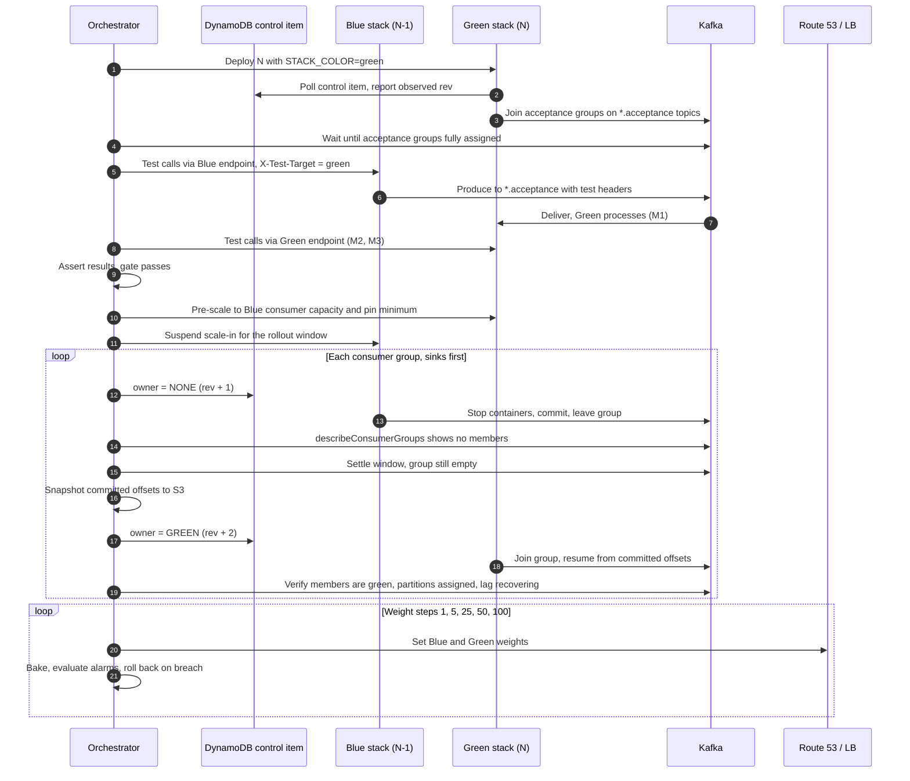
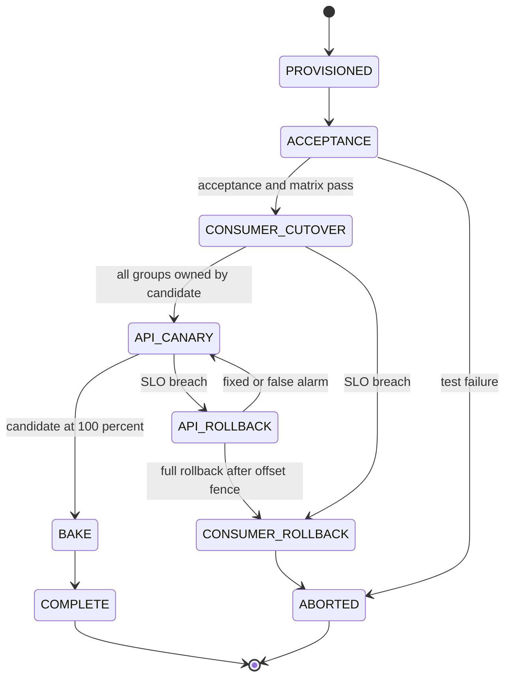

# Blue-Green and Canary Deployment Strategy for Spring Boot APIs and Kafka Consumers

> **Status:** Proposal for review
> **Scope:** Application 1 (APIs only) and Application 2 (APIs + Kafka consumers), all regions and stacks
> **Date:** October 2026

---

## Contents

1. [Executive summary](#1-executive-summary)
2. [Context, terminology and invariants](#2-context-terminology-and-invariants)
3. [Kafka mechanics that shape the design](#3-kafka-mechanics-that-shape-the-design)
4. [Analysis of the provided strategy](#4-analysis-of-the-provided-strategy)
5. [Alternative strategies](#5-alternative-strategies)
6. [Comparison of all strategies](#6-comparison-of-all-strategies)
7. [Recommended approach and test design](#7-recommended-approach-and-test-design)
8. [Synchronizing the API canary with the consumer switchover](#8-synchronizing-the-api-canary-with-the-consumer-switchover)
9. [Container lifecycle and scaling scenarios](#9-container-lifecycle-and-scaling-scenarios)
10. [Observability and automated gates](#10-observability-and-automated-gates)
11. [Adoption roadmap](#11-adoption-roadmap)
- [Appendix A — Naming conventions](#appendix-a--naming-conventions)
- [Appendix B — Verification snippets](#appendix-b--verification-snippets)

---

## 1. Executive summary

The provided strategy (stack-aware consumers, acceptance topic first, dynamic flip, then a Route 53 ramp) has the right shape and should be the base of the design. It gets the single most important ordering right: **consumers move to the new version before producers do**, so rolling forward only requires *backward* compatibility.

It needs hardening in four places before it is production-safe:

1. **Group identity.** Functional consumer groups must keep the **same `group.id` on both colors**. The flip is then a partition handover with continuous offsets. A color-suffixed group id would start from `auto.offset.reset` and either skip the backlog or replay the whole retention window.
2. **Flip sequencing.** "Simultaneously" is a race between independent pollers. Replace it with a versioned control item in DynamoDB and a per-consumer-group **drain → verify → start** handshake, verified against Kafka itself (`describeConsumerGroups`), not only against what instances report.
3. **Acceptance isolation.** Acceptance subscriptions belong in **ephemeral, per-deployment consumer groups** on dedicated acceptance topics, never in functional groups. Test records are addressed to a specific deployment so neither color double-processes them.
4. **Old-stack test routing.** The backward-compatibility test only works if the *old* (N-1) build can route tagged test requests to acceptance topics. That capability has to ship one release before the first deployment that relies on it.

On top of that:

- Add gradual exposure on the consumer side by flipping **one consumer group at a time**, downstream consumers before upstream ones, with an optional **partition-level canary** for high-risk groups.
- Keep **shadow consumption** for high-risk consumer-logic releases and **versioned topics** for genuinely breaking schema changes. Per-message cohort routing is not recommended as the default; its complexity isn't justified by these requirements.
- Rolling consumers back after the API canary has started needs either proven forward compatibility or an **offset fence**: wait until Green has consumed everything Green's API produced before handing partitions back to Blue.
- Containers start and stop at any point (autoscaling, replacement, host events, deployments). The design stays correct because a container's role is computed at runtime from the control item and its color; only the pipeline can change a color's service, and the orchestrator checks in ECS that each color runs the expected build before every step; Kafka membership is re-checked after a settle window; and the orchestrator sets **capacity floors and scaling suspensions** for both colors in every phase (section 9).

---

## 2. Context, terminology and invariants

### 2.1 Context

| Aspect | Current state |
|---|---|
| Applications | App 1: APIs only. App 2: APIs + Kafka consumers in the same process. |
| Topology | Multiple regions; multiple stacks per region. |
| Static config | Spring profiles per region and per stack. |
| Consumer config | Loaded dynamically from DynamoDB; multiple consumer groups per instance, multiple topics per group. |
| API canary | Load balancers + Route 53 weighting. |
| Testing | Acceptance suite on new deployments; a dedicated acceptance-test topic. |
| Hard requirement | Messages produced by the old stack must be processed correctly by the new stack, and all acceptance tests must pass, before full rollout. |

### 2.2 Terms

| Term | Meaning |
|---|---|
| **Color** | Blue or Green: the *identity* of a stack. Colors alternate every release, so Green is not always the new one. |
| **Live / Candidate** | The *role* a color currently plays. Roles are stored in DynamoDB, never in code or config files. |
| **N-1 / N** | The build currently live / the build being rolled out. |
| **Functional topics / groups** | Production topics and the consumer groups that process them. |
| **Acceptance topics / groups** | Test-only topics and the disposable groups that consume them. |
| **Control item** | DynamoDB item declaring which color owns each functional consumer group, plus rollout phase. |
| **Orchestrator** | The deployment pipeline (Step Functions, Spinnaker, Argo, CodePipeline, etc.). The only writer of the control item and of traffic weights. |

### 2.3 Design invariants

These are non-negotiable; every mechanism below exists to enforce one of them.

| # | Invariant |
|---|---|
| I1 | A functional consumer group has members from **at most one color**, except during an overlap the orchestrator explicitly declares. |
| I2 | Functional group ids, topics and serialization config are **identical on both colors**. Color changes identity (client ids, metric tags), never configuration. |
| I3 | Synthetic test records never enter functional topics; functional records never enter acceptance groups. |
| I4 | A color's API receives weighted production traffic only after its consumers own every functional group it produces to — or forward compatibility has been proven. |
| I5 | Every consumer is idempotent under redelivery. |
| I6 | Rollout state changes only through the orchestrator. Humans act through the orchestrator, not by editing DynamoDB or Route 53 directly. |
| I7 | A container's role is derived at runtime from the control item and its color. During a rollout each color's service runs exactly one task definition, which only the orchestrator can change. |
| I8 | During a rollout, the orchestrator sets capacity floors and scaling suspensions for both colors; autoscaling operates inside them. |

---

## 3. Kafka mechanics that shape the design

| Mechanic | Consequence for blue-green |
|---|---|
| Committed offsets are keyed by `(group.id, topic, partition)`. | Same group id on both colors → the new owner resumes exactly where the old one committed. A new group id starts at `auto.offset.reset`: `latest` silently skips the backlog, `earliest` replays the whole retention window. |
| Every consumer group receives every record. | Two colors in two different groups on the same functional topic means every record is processed twice. |
| `pause()` keeps partition ownership; `stop()` leaves the group. | Paused Blue consumers still hold their partitions, so lag grows and Green never receives them. Handover must **stop** (close) the containers. |
| Rebalance protocol. | Eager: every member stops on any join or leave. Cooperative sticky (`CooperativeStickyAssignor`) or the KIP-848 protocol (`group.protocol=consumer`, GA in Apache Kafka 4.0; check your MSK version): only moved partitions pause. Prefer incremental rebalancing. |
| Members of one group must share an assignor during overlap. | If Blue uses only `RangeAssignor` and Green only `CooperativeStickyAssignor`, they can't join the same group at the same time. Change assignors with the documented two-step rolling procedure, never in the same release as an overlap flip. |
| Handover is at-least-once. | Records processed but not committed when a partition is revoked are redelivered to the new owner. Commit on revocation and make processing idempotent; don't try to make the flip exactly-once. |
| Compatibility has a direction. | **BACKWARD** (new reader, old data) → upgrade consumers before producers. **FORWARD** (old reader, new data) → needed to hand consumers back to the old version after new producers have emitted. **FULL** → both. |
| Data at rest is old. | Retention, consumer lag and DLT replays mean N reads data written by N-1, N-2 and earlier. Compatibility must be **transitive**. |

Two rules follow from this table and drive the rest of the document:

- **Consumers before producers, sinks before sources.** Any version that emits a new message shape must only be emitting to consumers already running a version that understands it. This applies between the API and consumers, between chained consumer groups, and between applications.
- **One group id, one owner at a time.** Production offsets stay continuous only when both colors share the functional group id and the handover is explicit.

---

## 4. Analysis of the provided strategy

### 4.1 Step-by-step assessment

| Step | Assessment | Gap | Hardening |
|---|---|---|---|
| **1. Stack-aware application** | Necessary. | Colors alternate; any logic that assumes "Green = new" breaks on the next release. Making color a Spring profile invites config drift between colors. | Inject color and a per-rollout deployment id as environment variables. Color drives identity and the evaluation of the control item; the deployment id only names per-rollout test groups and tags metrics. Live/candidate roles live in DynamoDB. |
| **2. New stack subscribes only to the test topic** | The correct gate: no production record reaches N before tests pass. | Which consumer group? If acceptance subscriptions share the functional group id, or Blue also consumes the test topic in the same group, test records split across colors. A single shared test topic also means Green's acceptance wiring differs from its functional wiring. | Ephemeral per-deployment acceptance groups. One acceptance topic per functional topic (or a header-tagged logical topic). Same listener beans and container factory as the functional path. |
| **3. Acceptance tests + old-stack traffic** | The key backward-compatibility check, run against real N-1 binaries. | Blue's API produces to *functional* topics unless N-1 already knows how to route test requests elsewhere. Sending "a percentage of test traffic" through weighted Route 53 also mixes it with real users. | A test-routing contract shipped in N-1; the test harness calls per-color endpoints directly; records are addressed to a target color. |
| **4. Dynamic flip** | The right mechanism: config-driven, fast, reversible. | "Simultaneously" is a race between independent pollers, so you get overlap or a gap depending on timing. Flipping all groups at once is a 0→100% jump for consumers. Nothing verifies that Blue actually left the groups. | Versioned control item; per-group drain → verify (Kafka AdminClient) → start; risk-ordered group sequence; optional overlap as a partition canary. |
| **5. Route 53 ramp** | Correct ordering: consumers first. | Handing consumers back to Blue after Green's API has produced messages requires Blue to read N's messages (forward compatibility), which the plan doesn't test. DNS weighting is approximate. | Add a Green→Blue leg to the acceptance matrix, or use the offset-fence rollback. Measure the real traffic split from LB metrics. |

### 4.2 Practical implementation

#### 4.2.1 Stack identity

The pipeline injects two values per stack. Both colors run the **same artifact with the same profiles**; color is not a profile.

```yaml
deployment:
  color: ${STACK_COLOR}                 # blue | green, injected by the pipeline
  deployment-id: ${DEPLOYMENT_ID}       # unique per rollout; names test groups and tags metrics only
  stack-id: ${STACK_ID}                 # e.g. prod#ap-south-1#stack-a
  control:
    table: ${CONSUMER_CONFIG_TABLE}
    poll-interval-ms: 5000

spring:
  kafka:
    client-id: orders-${deployment.color}            # Spring appends -n per consumer thread
    consumer:
      max-poll-records: 100                          # bounds drain time on stop
      properties:
        partition.assignment.strategy: org.apache.kafka.clients.consumer.CooperativeStickyAssignor
    producer:
      transaction-id-prefix: orders-${deployment.color}-${HOSTNAME}-   # only if you use transactions

management:
  metrics:
    tags:
      color: ${deployment.color}
      deployment.id: ${deployment.deployment-id}
```

Color appears only in client identity (`client.id`, `transactional.id`, `group.instance.id` if you use static membership) and metric tags. Shared static-member ids across colors cause partition stealing; shared transactional ids cause the two colors' producers to fence each other.

Because containers are ephemeral, two of these settings need extra care: stopped static members keep their partitions until the session times out, which stalls a handover, and a `transactional.id` derived from the hostname changes on every replacement, so a killed container leaves an open transaction that stalls `read_committed` consumers. Section 9.8 covers both.

#### 4.2.2 DynamoDB data model

Extend the existing consumer-config table with a control item, and keep instance heartbeats under a separate partition key so the config query stays small. Adapt key shapes to your current schema; the semantics are what matter.

**Consumer config item** (existing, lightly extended):

```json
{
  "pk": "STACK#prod#ap-south-1#stack-a",
  "sk": "CONSUMER#order-events",
  "groupId": "orders.order-events",
  "topics": ["orders.created", "orders.updated"],
  "concurrency": 6,
  "enabled": true,
  "risk": "high",
  "rolloutWave": 2
}
```

**Control item** (new, one per stack):

```json
{
  "pk": "STACK#prod#ap-south-1#stack-a",
  "sk": "CONTROL",
  "rev": 118,
  "phase": "CONSUMER_CUTOVER",
  "stacks": {
    "BLUE":  { "build": "4.12.0", "role": "LIVE" },
    "GREEN": { "build": "4.13.0", "role": "CANDIDATE" }
  },
  "ownership": {
    "audit-events":   { "owner": "GREEN" },
    "payment-events": { "owner": "NONE" },
    "order-events":   { "owner": "BOTH", "concurrency": { "GREEN": 1 } }
  },
  "acceptance": { "BLUE": true, "GREEN": true },
  "capacityBaseline": { "BLUE": { "desired": 12, "min": 8 } },
  "updatedBy": "pipeline/run-8812",
  "updatedAt": "2026-10-26T06:10:00Z"
}
```

| `owner` value | Meaning |
|---|---|
| `BLUE` / `GREEN` | Only that color runs functional containers for the group. |
| `NONE` | Nobody consumes; the drain step of a break-before-make handover. |
| `BOTH` | Both colors run functional containers in the **same** group; used for a partition canary or make-before-break overlap. Optional per-color concurrency. |

**Instance status item** (new, written by each instance, TTL-expired):

```json
{
  "pk": "STATUS#prod#ap-south-1#stack-a",
  "sk": "INSTANCE#GREEN#i-0a1b2c3d",
  "observedRev": 118,
  "running": ["audit-events:FUNCTIONAL", "order-events:FUNCTIONAL", "order-events:ACCEPTANCE"],
  "heartbeatAt": "2026-10-26T06:10:04Z",
  "expiresAt": 1792995064
}
```

Rules for the model:

- **Conditional writes.** The orchestrator writes the control item with `ConditionExpression: rev = :expected` and increments `rev`, so two pipelines can never interleave.
- **Region-local writes.** If the table is a global table, key control items by region and write them only in their own region. Global-table replication is asynchronous with last-writer-wins, so a cross-region write race could silently revert a flip.
- **Single derivation.** Each instance's desired state is a pure function of (control item, consumer config items, its own color). Nothing else.
- **Informational fields.** `build` and `role` are for the orchestrator and humans; containers don't act on them. Which build a color runs is the platform's job (section 9.2).

#### 4.2.3 Propagating changes

- **Poll as the source of truth.** Each instance queries its stack partition with `ConsistentRead=true` every 5 s. The cost is negligible (200 instances × 12 small reads/min).
- **Push is optional.** DynamoDB Streams can nudge instances to poll early, but correctness must never depend on it.
- **Fail static.** If DynamoDB is unreachable, keep whatever is running, emit a metric and alarm. Never start or stop containers on a failed read.
- **Fail closed at startup.** A new instance starts no functional container until its first successful read (taken after a small random delay, so a mass restart doesn't burst DynamoDB), and exposes that as an Actuator health component kept out of the load balancer's readiness check (section 9.3). This is also why ownership lives in DynamoDB rather than in environment variables: an instance launched by autoscaling in the middle of a flip reads the current state and lands in the right place.

#### 4.2.4 Reconciler in Spring Boot

Because consumer configs are dynamic, containers are created programmatically from the existing `ConcurrentKafkaListenerContainerFactory`, so error handlers, ack modes and deserializers are identical on functional and acceptance paths. (If some listeners are declared with `@KafkaListener`, give them ids and `autoStartup = "false"` and drive them through `KafkaListenerEndpointRegistry` the same way.)

```java
@Component
@RequiredArgsConstructor
class ConsumerReconciler {

    private final StackIdentity me;                 // color, deploymentId, service name
    private final ControlPlaneClient controlPlane;  // DynamoDB query with ConsistentRead
    private final ConsumerContainerManager containers;
    private final InstanceStatusReporter status;

    @Scheduled(fixedDelayString = "${deployment.control.poll-interval-ms:5000}")
    void reconcile() {
        Snapshot snap;
        try {
            snap = controlPlane.read();
        } catch (Exception e) {
            status.controlPlaneUnavailable(e);      // fail static: change nothing
            return;
        }
        containers.converge(DesiredState.compute(snap, me));   // idempotent, self-healing
        status.heartbeat(snap.rev(), containers.runningKeys());
    }
}
```

```java
final class DesiredState {

    static Map<String, ContainerSpec> compute(Snapshot s, StackIdentity me) {
        Map<String, ContainerSpec> out = new LinkedHashMap<>();
        for (ConsumerConfig c : s.consumers()) {
            if (!c.enabled()) continue;
            Ownership o = s.ownership(c.name());                       // BLUE | GREEN | BOTH | NONE
            if (o.includes(me.color())) {
                out.put(c.name() + ":FUNCTIONAL",
                        ContainerSpec.functional(c, me, o.concurrencyFor(me.color())));
            }
            if (s.acceptanceEnabled(me.color())) {
                out.put(c.name() + ":ACCEPTANCE", ContainerSpec.acceptance(c, me));
            }
        }
        return out;
    }
}

record ContainerSpec(String key, String consumerName, String groupId, List<String> topics,
                     String clientId, int concurrency, boolean acceptance, String color) {

    static ContainerSpec functional(ConsumerConfig c, StackIdentity me, OptionalInt override) {
        return new ContainerSpec(c.name() + ":FUNCTIONAL", c.name(),
                c.groupId(),                                           // identical on both colors
                c.topics(),
                me.service() + "-" + me.color().id() + "-" + c.name(),
                override.orElse(c.concurrency()), false, me.color().id());
    }

    static ContainerSpec acceptance(ConsumerConfig c, StackIdentity me) {
        return new ContainerSpec(c.name() + ":ACCEPTANCE", c.name(),
                c.groupId() + ".acc." + me.color().id() + "." + me.deploymentId(),   // ephemeral
                c.topics().stream().map(t -> t + ".acceptance").toList(),
                me.service() + "-" + me.color().id() + "-" + c.name() + "-acc",
                1, true, me.color().id());
    }
}
```

```java
@Component
@RequiredArgsConstructor
class ConsumerContainerManager implements SmartLifecycle {

    private final ConcurrentKafkaListenerContainerFactory<String, byte[]> factory;
    private final ListenerRegistry listeners;      // consumer name -> MessageListener bean
    private final OwnershipGuards guards;          // ownership check on partition assignment (section 9.6)
    private final Executor stopper;                // stops containers off the consumer thread
    private final Map<String, Running> running = new ConcurrentHashMap<>();
    private volatile boolean accepting;            // false once shutdown begins

    record Running(ContainerSpec spec, ConcurrentMessageListenerContainer<String, byte[]> container) {}

    synchronized void converge(Map<String, ContainerSpec> desired) {
        if (!accepting) return;                    // the reconciler must never restart containers during shutdown
        // 1. Stop what is no longer wanted (or whose spec changed) first: break before make.
        for (String key : List.copyOf(running.keySet())) {
            ContainerSpec want = desired.get(key);
            if (want == null || !want.equals(running.get(key).spec())) {
                stopGracefully(running.remove(key));
            }
        }
        // 2. Start what is wanted but not running.
        desired.forEach((key, spec) -> running.computeIfAbsent(key, k -> start(spec)));
    }

    private Running start(ContainerSpec spec) {
        var c = factory.createContainer(spec.topics().toArray(String[]::new));
        var props = c.getContainerProperties();
        props.setGroupId(spec.groupId());
        props.setClientId(spec.clientId());

        MessageListener<String, byte[]> listener = listeners.forConsumer(spec.consumerName());
        if (spec.acceptance()) {
            // Discard test records addressed to the other color; ack them so offsets advance.
            listener = new FilteringMessageListenerAdapter<>(listener,
                    rec -> !spec.color().equalsIgnoreCase(header(rec, "x-test-target")), true);
            c.setRecordInterceptor(new TestContextInterceptor());   // propagates test context downstream
        } else {
            c.setRecordInterceptor(new TestLeakQuarantine());       // functional path rejects test records
            props.setConsumerRebalanceListener(                     // catches a container started from a stale read
                    guards.forFunctional(spec, () -> stopper.execute(() -> stopIfStale(spec.key()))));
        }
        props.setMessageListener(listener);
        c.setConcurrency(spec.concurrency());
        c.setBeanName(spec.key());
        c.start();
        return new Running(spec, c);
    }

    private void stopGracefully(Running r) {
        var done = new CountDownLatch(1);
        r.container().stop(done::countDown);   // finish in-flight records, commit, leave the group
        try {
            if (!done.await(60, TimeUnit.SECONDS)) {
                // Emit a metric. The orchestrator's Kafka membership check will block the flip.
            }
        } catch (InterruptedException e) {
            Thread.currentThread().interrupt();
        }
    }

    private static String header(ConsumerRecord<?, ?> r, String name) {
        Header h = r.headers().lastHeader(name);
        return h == null ? null : new String(h.value(), StandardCharsets.UTF_8);
    }

    private synchronized void stopIfStale(String key) {
        Running r = running.remove(key);
        if (r != null) stopGracefully(r);          // the next converge re-evaluates from a fresh read
    }

    // SmartLifecycle with a high phase: consumers stop before the web server finishes draining
    // and before producer factories are destroyed (section 9.4).
    @Override public void start() { accepting = true; }

    @Override public synchronized void stop() {
        accepting = false;
        running.values().forEach(this::stopGracefully);
        running.clear();
    }

    @Override public boolean isRunning() { return accepting; }

    @Override public int getPhase() { return Integer.MAX_VALUE - 100; }
}
```

Implementation notes:

- `stop()`, not `pause()`. Only stopping releases partitions (see section 3).
- Keep drain time bounded: container-managed ack modes commit on revocation and on stop; `max.poll.records` × worst-case per-record time must stay under the stop timeout. Verify the commit-on-stop behavior for the ack mode you use.
- Adapt the listener wrapping if you use batch or acknowledging listeners.
- `converge` is idempotent and runs every poll, so a container that died is restarted and a spec change in DynamoDB (topics, concurrency) is applied without redeploying.
- The ownership guard and the shutdown ordering exist because containers come and go throughout a rollout; section 9 explains each.

#### 4.2.5 Flip protocol for one consumer group

**Default: break-before-make**

1. **Preconditions.** Acceptance and the compatibility matrix passed; Green is pre-scaled and capacity floors are set (section 9.5); the Green service runs only the expected task definition (checked in ECS) and every Green container reports the current `rev`; the group has had no rebalance for a short stability window; the control plane is healthy.
2. Orchestrator sets `ownership[g].owner = NONE` (rev r+1).
3. Blue reconcilers stop g's functional containers: finish in-flight records, commit, leave the group.
4. Orchestrator verifies **with Kafka** that `describeConsumerGroups(g)` has zero members, and that all Blue instances report `observedRev ≥ r+1`. It then waits a **settle window** (at least one poll interval plus container start time) and checks again, which catches a Blue container that started from a stale read just before step 2. If static membership is in use, it removes the stopped Blue members explicitly (section 9.8). On timeout (e.g. 2 minutes, and never shorter than `session.timeout.ms`), restore `BLUE` and abort.
5. Snapshot g's committed offsets (`listConsumerGroupOffsets`) to S3 with the deployment id, for audit and as a rollback reference.
6. Orchestrator sets `ownership[g].owner = GREEN` (rev r+2).
7. Verify: the group has members, every member's `client.id` contains `-green-`, every partition is assigned, committed offsets advance, lag returns to baseline, and no Blue member appears during a second settle window.
8. Bake for the group's configured window, then move to the next group.

The consumption pause per group is roughly two poll intervals plus drain time: typically 10–30 s with a 5 s poll and bounded `max.poll.records`.

**Optional: make-before-break (overlap)**

For groups that can't tolerate the pause, or that you want to canary on real traffic:

1. Set `owner = BOTH` with Green at low concurrency. Green joins the same group; a cooperative rebalance moves a subset of partitions to Green.
2. Bake. This is Strategy A (section 5.1), a partition canary.
3. Set `owner = GREEN`. Blue stops; its remaining partitions move to Green.
4. Verify as in step 7 above.

**Group order.** Flip in reverse topological order, sinks before sources: if group `enrich` consumes `orders.created` and produces `orders.enriched`, which group `notify` consumes, flip `notify` first. Then every message N emits is consumed by N. Within a level, go from lowest to highest risk.

#### 4.2.6 Failure modes

| Situation | Behavior | Mitigation |
|---|---|---|
| DynamoDB unreachable | Instances fail static | Alarm; orchestrator does not advance without fresh heartbeats. |
| Autoscaling launches an instance mid-flip | It reads the current `rev` and joins the correct state | The ownership guard and the settle window cover a stale read (section 9.6). |
| A container is killed mid-drain (SIGKILL, OOM, host loss) | No commit; its partitions stay assigned until `session.timeout.ms` | The orchestrator waits at least the session timeout before aborting; idempotency handles redelivered records. |
| Static members stop | They don't leave the group, so partitions stay held until the session times out | Remove the members via AdminClient during handover, or don't use static membership for these groups (section 9.8). |
| A color's service changes outside the orchestrator (manual update, ECS circuit-breaker rollback) | New tasks run a build the orchestrator didn't validate | Only the pipeline role can update color services; the orchestrator watches ECS deployment events and aborts (section 9.2). |
| A Blue instance does not drain (stuck handler, or cut off from DynamoDB but not Kafka) | Kafka still shows a Blue member in g | Timeout → abort, or the orchestrator terminates that instance and re-verifies. |
| Green crash-loops after taking g | Lag rises, members churn | Automatic rollback of g to `BLUE`; same group, so offsets continue. |
| Poison message after the flip | Green's error handler routes it to a DLT | `DefaultErrorHandler` + `DeadLetterPublishingRecoverer`; DLT rate is a gate metric. |
| Orchestrator dies mid-flip | Control item holds the last `rev` and phase | Make the orchestrator resumable (e.g. Step Functions); state lives in DynamoDB, not pipeline memory. |
| Two pipelines run at once | Conditional write fails | `rev` check. |

Section 9.6 walks through every container lifecycle scenario by rollout phase.

### 4.3 Pros and cons of the provided strategy

**Pros**

- Exercises the real N build in the real environment (VPC, IAM and MSK auth, ACLs, DynamoDB config, secrets) before it touches a production record.
- Tests backward compatibility against the actual N-1 binary, not a fixture.
- With a shared group id, handover needs no offset translation, no new production topics and no extra broker load.
- Reuses the existing DynamoDB-driven consumer model; ownership is just one more attribute.
- Rollback is a config write: seconds plus drain time, with Blue kept warm.
- Consumer-first ordering means only backward compatibility is needed to roll forward.
- A clear, auditable gate: tests pass, then the flip happens.

**Cons**

- As written, consumers go from 0% to 100% of real traffic in one step; no gradual consumer exposure.
- Synthetic coverage is only as good as the acceptance suite. It doesn't exercise production data variety, volume, hot keys or rebalancing under load.
- Requires the N-1 build to support test routing and the reconciler, so a one-time enabling release is needed.
- Correctness depends on the control plane: propagation delay, DynamoDB availability, autoscaling during the flip, straggler instances.
- A short consumption pause per group during break-before-make handover.
- Forward compatibility is untested, which makes rollback after the API ramp risky.
- Acceptance topics need test-data hygiene: test tenants, stubbed side effects, cleanup.

---

## 5. Alternative strategies

### 5.1 Strategy A — Shared-group partition canary

**How it works.** Green instances join the **same** functional consumer group with a small number of consumer threads. The assignor gives them a share of partitions roughly proportional to their share of members; those partitions, and every key that hashes to them, are processed by N on real traffic. Ramp by raising Green's concurrency or instance count and lowering Blue's; finish by removing Blue.

**Example.** A 48-partition topic with Blue at 8 instances × concurrency 3 = 24 members (two partitions each). Adding one Green instance at concurrency 2 gives 26 members; a cooperative sticky rebalance moves a few partitions to Green, roughly 4–8% of keys.

**Implementation notes**

- In the control-item model this is `owner: BOTH` with a Green concurrency override.
- **Idle-member trap:** when total members ≥ partitions, sticky assignment keeps existing owners and can leave new Green members with nothing. Keep total members below the partition count during the canary.
- Precise control (exactly k partitions to Green) needs a custom `ConsumerPartitionAssignor` that reads color from member metadata. That only works with the classic rebalance protocol; the KIP-848 protocol uses broker-side assignors, so a custom client assignor becomes a long-term liability.
- Compare Green and Blue per partition and watch for partition skew.

**Pros**

- Real production traffic on N, with no new topics, groups or extra reads.
- Offsets stay continuous; per-key ordering is preserved because a partition has one owner at a time.
- Rollback is just removing Green's members.
- Composes naturally with the control-item model.

**Cons**

- The canary unit is a whole partition. A large tenant on a canary partition means a large blast radius, and the sample isn't random, so Blue-vs-Green comparisons can be biased.
- Every ramp step is a rebalance with some redelivery.
- Granularity is coarse (1/partition count at best).
- Does not validate before touching production; it needs the acceptance gate in front of it.
- Downstream topics carry mixed-version output during the canary.
- The canary share depends on member counts, so any container joining or leaving either color (autoscaling, crash, replacement) changes it and can move keys between versions mid-canary. Capacity has to be frozen for the window (section 9.7).

**Best for:** high-risk consumer groups, as a step between acceptance and full ownership.

### 5.2 Strategy B — Shadow (dark) consumption, then handover

**How it works.** Green runs an additional, disposable consumer group (`<group>.shadow.<deploymentId>`) on the functional topics. Before it starts, its offsets are seeded from Blue's committed offsets (`alterConsumerGroupOffsets`; allowed because the new group is empty), so it processes the same live stream. Every side effect is redirected: database writes to shadow tables, produces to `<topic>.shadow`, external calls to stubs or recorders. A diff service compares Blue's real outputs with Green's shadow outputs by message id. When the diff is clean, cutover uses the normal same-group handover from section 4.2.5, and the shadow group is deleted.

A variant (B2) runs permanent per-color production groups (`<group>.blue`, `<group>.green`) and translates offsets at cutover. It works, but every deployment becomes an offset-management operation, and an idle color's committed offsets expire after `offsets.retention.minutes` (seven days by default), which can turn a late rollback into an accidental reset. Prefer B1.

**Pros**

- Full production traffic with zero customer impact.
- The strongest backward-compatibility evidence available: N reads exactly what N-1 and older producers wrote, including odd historical shapes.
- Finds performance regressions at real volume and semantic regressions the acceptance suite misses.

**Cons**

- Side-effect isolation must be total. One missed sink (a payment call, an email, a webhook, a cache write) causes real duplicate effects.
- Every sink needs an abstraction with a shadow mode, a significant code investment.
- Shadow mode must be scoped to the container and default to shadow sinks, so a newly started container can never come up writing to real sinks; shadow containers also must not start before the group's offsets are seeded (section 9.7).
- Stateful logic reads real state but writes shadow state, so diffs get noisy; non-deterministic fields (timestamps, generated ids) need normalizing.
- Roughly doubles broker fetch load for the shadowed groups, plus shadow storage and a diff service.

**Best for:** releases that materially change consumer business logic, and high-value flows where a canary mistake is expensive. Run it selectively, not on every deployment.

### 5.3 Strategy C — Cohort routing by header or key

**How it works.** Both colors consume every functional topic in **separate** groups (`<group>.blue`, `<group>.green`). Each record maps to a cohort, either from an `x-cohort` header set at the API edge (the same cohort used for the API canary) or from `hash(key) % 100`. Green processes records with cohort < p; Blue processes the rest; each discards the other's records (`RecordFilterStrategy` with `ackDiscarded=true`). p lives in DynamoDB.

**Changing p safely.** The two groups sit at different offsets, so a naive change produces gaps (records skipped by both) or duplicates (processed by both). The fix is to version p by offset: for each partition, a new p applies only from a fence offset at or beyond the log-end offset at change time. Both colors evaluate the same deterministic rule for every `(partition, offset)`, so their sets stay exact complements. Preserving per-key order across the boundary additionally requires Green to hold each partition until Blue's committed offset passes the fence.

**Pros**

- Fine-grained, unbiased canary: 1%, specific tenants, internal users first.
- End-to-end cohort alignment: a tenant's API calls and asynchronous processing run on the same version, which gives the cleanest signal.
- Rollback for new records is a config change with no rebalance.
- Group membership doesn't decide which color processes a record, so each color can autoscale and replace containers freely.

**Cons**

- Every record is read and deserialized twice.
- Complement correctness is a single point of failure: a filter bug loses or duplicates records.
- Fence and barrier logic is custom, subtle and hard to test.
- Lag in either group matters for correctness at the boundary.
- Header-based cohorts require N-1 producers to stamp headers; retry and DLT topics must respect cohorts too.
- Adds permanent complexity to every consumer.
- Every container must hold the current epoch list before processing anything, and must stop consuming if its view goes stale, which ties consumer availability to the config store. Each color must also be sized to read the full stream regardless of its share.

**Best for:** multi-tenant platforms that must canary tenant-pinned, end-to-end flows. Usually adopted through a shared platform library rather than per service.

### 5.4 Strategy D — Versioned topics with dual-write or a bridge

**How it works.** N consumes `<topic>.v2`; N-1 consumes `<topic>.v1`. Either producers write both topics (Kafka transactions can make that atomic within one cluster), or a bridge, such as a Kafka Streams application with exactly-once processing, translates v1→v2 (and v2→v1 for rollback). Cutover moves consumers and then producers to v2; v1 retires after a bake period.

**Offset mapping.** Green's v2 group has to start at the v2 position equivalent to Blue's v1 commit. Have the bridge write the source partition and offset into a header so the mapping is exact.

**Pros**

- The only strategy that handles genuinely **breaking** schema changes.
- Old and new consumers are fully isolated and can run in parallel for validation.
- Rollback is independent of the new version.

**Cons**

- Doubles storage and topic count.
- The bridge is another stateful, exactly-once service to operate.
- Keys and partition counts must match across versions, or per-key order breaks.
- Offset mapping at cutover.
- Heavy operational cost for every change that uses it.

**Best for:** planned migrations where the change cannot be expressed as expand/contract.

### 5.5 Reference baseline — in-place rolling update

Rolling instances in the same group with no explicit gate. It's included in the comparison only as a reference point: it relies entirely on compatibility being right and gives no controlled exposure.

---

## 6. Comparison of all strategies

| Criterion | Baseline rolling | Provided (as written) | A. Partition canary | B. Shadow + handover | C. Cohort routing | D. Versioned topics |
|---|---|---|---|---|---|---|
| Validates on real traffic before full exposure | No | No (synthetic only) | Yes | Yes, 100% with no impact | Yes | Yes, via bridge |
| Proves N-1 producer → N consumer | Only by exposure | Yes, synthetic | Yes, real data, no pre-gate | Yes, strongest | Yes, for the cohort | Tests translation, not compat |
| Consumer canary granularity | Uncontrolled | None (0→100%) | Per partition | 100% shadow, 0% live | Fine (1%, tenant) | Per topic |
| Offset continuity risk | Low | Low with shared group id, high otherwise | Low | Low (B1), medium (B2) | Medium (two groups, fencing) | Medium (v1→v2 mapping) |
| Duplicate-processing risk | Low (rebalance only) | Low–medium (flip race) | Low | High if any side effect leaks | Medium–high (filter bugs) | Medium (bridge/dual write) |
| Per-key ordering | Preserved | Preserved if sequenced | Preserved | Preserved after cutover | At risk at cohort boundaries | Preserved if keys/partitions match |
| Blast radius during canary | Grows with the roll | 100% at flip | Keys on canary partitions | None | Exactly the cohort | Depends on cutover |
| Rollback speed | Slow (redeploy) | Seconds | Seconds | N/A before cutover | Seconds for new records | Fast with a down-bridge |
| Extra runtime cost | None | Low (test topics) | None | High (2× reads, shadow stores) | Medium (2× reads) | High (2× storage, bridge) |
| Implementation complexity | Lowest | Medium | Low (default assignor) / high (custom) | High | Very high | High |
| Needs capabilities in N-1 | No | Yes (test routing, reconciler) | No | No | Yes, if header-based | Dual-write or bridge |
| Handles breaking schema changes | No | No | No | Partly (detects them) | No | **Yes** |
| Fit with DynamoDB consumer config | N/A | Native | Good (`BOTH` + concurrency) | Good (shadow container type) | Possible (p in config) | Topics per version |
| Coordination with Route 53 API canary | None | Good (consumer-first) | Independent; precedes API ramp | Precedes API ramp | Excellent (same cohort) | Neutral |
| Robustness to container churn and autoscaling | Version mix depends on which tasks get replaced | Good with the ownership guard and capacity floors | Poor: canary share drifts with every join or leave | Good if shadow mode is container-scoped | Best for membership churn; fragile to stale config | Good; bridge churn adds lag |

**When to use each**

| Strategy | Use when |
|---|---|
| Hardened provided strategy | Default for every release. |
| A. Partition canary | A consumer group is high-risk and you want real-traffic exposure before full ownership. |
| B. Shadow | The release changes consumer business logic in a high-value flow, and sinks are already abstracted. |
| C. Cohort routing | You need tenant-pinned end-to-end canaries and can invest in a platform library. |
| D. Versioned topics | A schema change is breaking and can't be done expand/contract. |

---

## 7. Recommended approach and test design

### 7.1 Recommended composite

Use the **hardened provided strategy** as the default path, with the other strategies as targeted tools:

1. **Shift-left compatibility** in CI (section 7.2, layer L0). Most compatibility failures should never reach a deployment.
2. **Deploy Green** with consumers in acceptance mode only; Route 53 weight 0.
3. **Run acceptance and the compatibility matrix** through acceptance topics, with test traffic sent to per-color endpoints.
4. **Consumer cutover group by group**, sinks before sources. Break-before-make by default. For groups marked `risk: high`, insert a partition-canary step (Strategy A) and bake.
5. **API ramp** through Route 53 or ALB weights (section 8).
6. **Bake, then retire Blue**, keeping it warm for the rollback window.

Optional: shadow consumption (Strategy B) for releases the pipeline flags as high-risk consumer-logic changes. Versioned topics (Strategy D) only when the CI compatibility check fails and the change can't be reworked as expand/contract.

### 7.2 Layered compatibility testing

| Layer | Where | What it proves | Mechanism |
|---|---|---|---|
| **L0** | CI | Schema-level backward (and ideally forward) compatibility, transitively | Schema registry (Confluent or AWS Glue) with `BACKWARD_TRANSITIVE` at minimum, `FULL_TRANSITIVE` if you want rollback without offset fences. Without a registry: each release publishes a **golden corpus** of serialized sample messages (every event type and variant, plus DLT samples); N's consumer tests deserialize and process the corpora of the last K releases. Make sure unknown-property failures are disabled on every deserializer, including Kafka's. |
| **L1** | Staging | Behavioral compatibility of the real binaries | N-1 and N deployed side by side; full compatibility matrix; optional replay of an anonymized production sample. |
| **L2** | Production, acceptance topics | The real N-1 binary in production talking to the real N binary | Section 7.4. Mandatory gate. |
| **L3** | Production, functional topics | Behavior on real traffic | Per-group flip with SLO gates; partition canary for high-risk groups. |
| **L4** | Production, shadow (optional) | Semantic equivalence on full traffic | Strategy B. |

### 7.3 Compatibility matrix

| # | Producer | Consumer | Proves | Gate |
|---|---|---|---|---|
| M1 | N-1 (Blue API or consumers) | N (Green acceptance groups) | Backward compatibility with live binaries | **Mandatory** before any consumer flip |
| M2 | N (Green) | N (Green) | Functional correctness of N | **Mandatory** |
| M3 | N (Green) | N-1 (Blue acceptance groups) | Forward compatibility, i.e. fast rollback after the API ramp | Mandatory if you want instant full rollback; otherwise rely on the offset-fence rollback |
| M4 | Retained data and DLT samples (N-2 and earlier) | N | Transitive compatibility | CI corpus (L0), optional staging replay (L1) |

### 7.4 Acceptance test topology

**Topics.** One acceptance topic per functional topic (`orders.created.acceptance`), 1–3 partitions, short retention (e.g. 24 h), same serializer and schema. If you use a schema registry with the default topic-name subject strategy, the acceptance topic gets its own subject; either use a record-name strategy or register the same schema with the same compatibility mode, so the acceptance path tests the same contract. This is better than a single shared test topic because each consumer group's real listener wiring (deserializer, error handler, concurrency, DLT) is exercised. If you keep a single shared topic, every record must carry an `x-logical-topic` header and each acceptance group must filter to its own logical topics.

**Groups.** `<functional-group>.acc.<color>.<deploymentId>`: unique per deployment, so there are no residual offsets and no interference between colors or runs. Use `auto.offset.reset=latest`, wait until the group shows full partition assignment before the harness produces anything, and delete the group (`deleteConsumerGroups`) when the deployment finishes.

**Test-routing contract** (must ship in N-1 first):

| Hop | Behavior |
|---|---|
| API request | Carries `X-Test-Run-Id` and `X-Test-Target` (the color whose consumers should process the result). Accepted only from an authenticated test principal (mTLS client, IAM role or allow-listed client id); ignored otherwise. |
| Producer | A single publisher choke point resolves `<topic>` → `<topic>.acceptance` when a test context is present and copies `x-test-run-id` and `x-test-target` onto the record. |
| Acceptance consumer | Discards records whose `x-test-target` isn't its own color. Because each rollout creates fresh acceptance groups that start at `latest`, records targeted at the same color in earlier rollouts are never read. A `RecordInterceptor` re-establishes the test context, so anything it produces downstream also goes to acceptance topics with the same headers. |
| Async boundaries | Propagate the test context through `@Async` executors (`TaskDecorator`) and any other thread hand-offs. |

```java
/** The only way application code publishes. Ships in N-1 before the first deployment that relies on it. */
@Component
@RequiredArgsConstructor
public class RoutingKafkaPublisher {

    private final KafkaTemplate<String, byte[]> template;

    public CompletableFuture<SendResult<String, byte[]>> publish(String logicalTopic, String key, byte[] payload) {
        TestContext test = TestContext.current();      // set by a servlet filter or RecordInterceptor
        String topic = (test == null) ? logicalTopic : logicalTopic + ".acceptance";

        ProducerRecord<String, byte[]> record = new ProducerRecord<>(topic, key, payload);
        if (test != null) {
            record.headers().add("x-test-run-id", test.runId().getBytes(UTF_8));
            record.headers().add("x-test-target", test.targetColor().getBytes(UTF_8));
        }
        assertNoLeak(record);
        return template.send(record);
    }

    private static void assertNoLeak(ProducerRecord<?, ?> r) {
        boolean isTest = r.headers().lastHeader("x-test-run-id") != null;
        boolean isAcceptanceTopic = r.topic().endsWith(".acceptance");
        if (isTest != isAcceptanceTopic) {
            throw new IllegalStateException("Test/functional topic mismatch for " + r.topic());
        }
    }
}
```

Enforce the guard in this choke point rather than in a Kafka `ProducerInterceptor`: the producer catches and logs exceptions thrown from `ProducerInterceptor.onSend`, so an interceptor can't block a send. Add an ArchUnit rule that forbids direct `KafkaTemplate` use outside the publisher.

**Leak guards, both directions.** Functional containers use a `RecordInterceptor` that quarantines any record carrying `x-test-run-id` (skip, publish to a quarantine topic, increment an alarmed counter). The counter must stay at zero.

**Driving traffic.** The harness calls **per-color endpoints** (each color's internal LB DNS name), never the weighted Route 53 name. For M1 it calls Blue's API with `X-Test-Target: green`; for M3 it calls Green's API with `X-Test-Target: blue`. The "small percentage of test traffic on the old stack" in the original plan becomes this: synthetic, targeted calls, not a slice of user traffic.

**Assertions.** Poll Green's read APIs (or the datastore) by test-run id with a time box. Fail the gate on any deserialization error, DLT publish or timeout.

**Data isolation.** Dedicated test tenants or accounts; third-party integrations (payments, notifications, partners) switched to sandboxes based on the tenant; cleanup by test-run id plus TTL.

### 7.5 Guardrails against duplication and offset corruption

1. **One functional group id per logical consumer, shared by both colors.** Never derive it from color, build or deployment id.
2. **Never mix paths.** A functional group never subscribes to an acceptance topic, and an acceptance group never subscribes to a functional topic.
3. **Acceptance groups are per deployment and disposable.** Delete them when the rollout finishes.
4. **Synthetic records never reach functional topics.** Enforced at the publisher choke point and quarantined by functional consumers if one ever appears.
5. **Hand over with stop, never pause.** Break-before-make unless the orchestrator explicitly declares an overlap.
6. **Kafka is the source of truth for membership.** Verify with `describeConsumerGroups` before declaring a handover complete; instance self-reports are advisory.
7. **Commit on revocation and bound drain time.** Container-managed ack modes, modest `max.poll.records`, stop timeout above worst-case batch time.
8. **Idempotent consumers.** Deduplicate on a producer-assigned message id (header) or on a natural key with a uniqueness constraint. Redelivery at handover is expected, not exceptional.
9. **Offsets move only by consumption.** Admin offset operations run only from the orchestrator, only on an empty group, and only after snapshotting current offsets.
10. **Consider `auto.offset.reset=none` on established functional groups,** so an accidental new group id or expired offsets fail loudly instead of silently skipping or replaying. New groups then need explicit offset seeding.
11. **Unique client identity per color**: `client.id`, `group.instance.id` and `transactional.id` prefix all include color.
12. **Same artifact and config on both colors.** Color selects identity and ownership only.
13. **Schema compatibility enforced at registration,** transitively.
14. **One build per color during a rollout.** Only the pipeline role can update a color's service; the orchestrator verifies the running task definition in ECS before every step.
15. **No churn hazards in client identity.** Avoid static membership on groups that change owner (or remove members at handover), and use stable transactional-id slots rather than per-container ids (section 9.8).

---

## 8. Synchronizing the API canary with the consumer switchover

### 8.1 Phase plan (Application 2)

| Phase | Kafka consumers | API weights (Blue / Green) | Exit gate |
|---|---|---|---|
| **P0 Provision** | Orchestrator records Blue's capacity baseline, then launches Green; no functional containers; acceptance groups created | 100 / 0 | Green's ECS deployment has completed with only the new task definition running, at its target count; every Green container reports the current `rev`. |
| **P1 Acceptance** | Green: acceptance. Blue: functional + acceptance (for M3). | 100 / 0 (test traffic to per-color endpoints) | Acceptance suite + M1, M2 (and M3 if adopted) pass. |
| **P2 Consumer canary** | Green pre-scaled to Blue's consumer capacity and Blue scale-in suspended; then groups flipped to Green one at a time, sinks first; partition canary for high-risk groups | 100 / 0 | Per-group lag, error and DLT rate, and business KPIs within thresholds for the bake window. |
| **P3 Consumer cutover complete** | Green owns every group; Blue consumers off, instances warm | 100 / 0 | Stack-level bake. |
| **P4 API canary** | Green | 99/1 → 95/5 → 75/25 → 50/50 → 0/100 | API SLOs and consumer SLOs at every step. |
| **P5 Bake and retire** | Green | 0 / 100 | Bake window (e.g. 24 h); acceptance groups deleted; Blue scaled down but kept deployable. |

Capacity rules for every phase, including rollbacks, are in section 9.5.

**Application 1 (APIs only)** uses P0, P1 (API acceptance via its per-color endpoint), P4 and P5. If App 1 produces messages that App 2 consumes, see section 8.7.

**Why consumers first.** In P2–P3 every message still comes from Blue's API (N-1), and Green's consumers have already proven they read it (M1). From P4 onward Green's API emits N-format messages, and only N consumers are listening. At no point does N-1 code read N output, so forward compatibility is needed only for rollback.

### 8.2 Sequence



### 8.3 Rollout state machine



### 8.4 Route 53 and load balancer practicalities

- **Weights are relative (0–255).** If every record in a weighted set has weight 0, Route 53 answers with all of them equally, so never set both colors to 0.
- **Attach health checks** to each weighted record so an unhealthy Green is dropped from answers automatically. If every record is unhealthy, Route 53 treats them all as healthy.
- **DNS shifts are approximate and lagged.** Use a low TTL (≤ 60 s) during rollouts. Client resolvers and JVM DNS caching (`networkaddress.cache.ttl`) delay the effect, and a few large clients behind one resolver can skew the real split.
- **Long-lived connections stay pinned** to the old LB. Cap connection lifetime on the server and LB side (e.g. Tomcat keep-alive limits, the ALB client keep-alive duration) so clients reconnect and pick up new weights.
- **Measure, don't assume.** Gate on the actual split from per-color LB `RequestCount`, not the configured weight.
- **For per-request precision within a region,** consider putting both colors' target groups behind one ALB with a weighted forward action, keeping Route 53 for regional routing and failover. ALB listener rules on a header or cookie can also send internal or dogfood tenants to Green before any percentage-based ramp.

### 8.5 Rollback playbooks

| Scenario | Trigger | Action | Compatibility dependency |
|---|---|---|---|
| **R1** Consumer regression before the API ramp (P2–P3) | Lag, error or DLT rate, or KPI on a Green-owned group | Hand that group back: `NONE` → `BLUE`. Blue resumes from Green's committed offsets. Roll back other Green-owned groups in reverse rollout order if needed. | None for API-produced data. If a Green-owned *upstream* group has emitted N-format records, roll it back first and fence its downstream groups as in R3. |
| **R2** API regression during the ramp (P4) | API errors, latency or KPI | Set weights to Blue 100 / Green 0. Consumers stay on Green, which reads both formats. | None. Then choose fix-forward or full rollback. |
| **R3** Full rollback after the ramp started | Either | 1) Do R2. 2) Wait for TTL + connection drain until Green's LB request count is about zero. 3) Record the log-end offsets of every topic Green's API produces to (the **offset fence**). 4) Wait until Green's committed offsets pass the fence on every partition. 5) Hand groups back to Blue, sources first. | None: the fence guarantees Blue never reads N-format records. Steps 3–4 can be skipped only if M3 passed. |
| **R4** Green consumers are the problem after the API ramp | Consumer SLO breach during P4 | If M3 passed: R2, then hand groups back immediately. Otherwise: R2, then either hold consumption (`NONE`, accepting lag) while a fix ships, or fence and hand back. | Forward compatibility decides how fast you can recover. |

Every playbook starts by restoring Blue's capacity to the recorded baseline and waiting until all Blue containers report the current `rev`, and keeps Green's capacity pinned until any offset fence has passed and groups are handed back (section 9.5).

Any messages Green sent to DLTs will later be replayed by whichever version owns the group; include DLT samples in the compatibility corpus (M4).

### 8.6 Multi-region and multi-stack rollout

- **Waves.** Start with one canary region (enough traffic to be meaningful, small enough to limit blast radius), then the remaining regions in batches. Each region and stack has its own control item and orchestrator execution, with a pipeline gate between waves.
- **Cross-region replication changes the ordering rule.** If consumers in one region read topics replicated from another (MirrorMaker 2, MSK Replicator), a region whose API emits N-format records may reach N-1 consumers elsewhere. Either finish the consumer cutover in *every* region that consumes those topics before starting the API ramp in *any* of them, or require forward/full compatibility.
- **Stack-scoped group ids.** If stacks in a region share a cluster but are meant to consume independently, make sure their group ids are stack-scoped; otherwise flipping one stack moves partitions belonging to another.

### 8.7 Ordering across applications

If App 1 produces records that App 2 consumes, App 1 is an upstream producer, and the same rule applies: App 2's consumers must be running N (or proven compatible) before App 1's new build emits new shapes. In practice, either deploy App 2 first in the release train, or keep App 1's message changes additive and registered so App 2's current consumers already accept them.

---

## 9. Container lifecycle and scaling scenarios

Both applications run in containers, and containers start and stop at every point of a rollout: autoscaling, crash and health-check replacement, host and AZ events, spot interruptions, platform patching, and the deployments themselves. A mechanism that is only correct for the containers present when a step began is not correct. This section sets out the rules that keep every phase safe under that churn, walks through the scenarios phase by phase, and then looks at how churn affects each strategy.

### 9.1 Principles

1. **Late joiners converge.** A container that starts at any moment reaches the same state as one that has been running all along, because its role is computed from the control item rather than pushed to the containers that existed at the time.
2. **Identity comes from the color's service; role comes from the control item.** Color is fixed in the color's task definition and never changes during a container's life; which build that service runs is controlled by the pipeline, not by containers.
3. **Kafka is the referee.** A handover is complete when Kafka's view of group membership says so, checked twice across a settle window.
4. **Graceful when possible, correct when not.** The SIGTERM path commits and flushes; the SIGKILL path relies on redelivery and idempotency.
5. **The orchestrator owns capacity during a rollout.** Autoscaling keeps working, but inside floors and suspensions the orchestrator sets for each phase.

### 9.2 Container identity and build consistency

- Each color in each stack is its own service (an ECS service or a Kubernetes Deployment), with `STACK_COLOR` set in its task definition or pod template. Every container the service launches (initial, scaled out or replacement) runs the service's current task definition, so color plus the service's task definition fully identifies the build. Containers don't need to know or check which build their color is supposed to run.
- The `DEPLOYMENT_ID` environment variable only names per-rollout acceptance and shadow groups and tags metrics. It isn't stored in DynamoDB and containers don't compare it against anything.
- **Why the control item doesn't track builds.** A per-build check in DynamoDB would only guard against a color's service running something the orchestrator didn't validate. The cases where that could happen are already covered:
  - *Old candidate-color tasks still running while the candidate is redeployed (P0).* The candidate owns no groups, and acceptance isn't enabled until the P0 gate confirms in ECS that the deployment has completed with only the new task definition running.
  - *A retired color restarted later.* It owns nothing, so it consumes nothing. It can only own groups again after being redeployed and validated as a candidate.
  - *An out-of-band update or ECS circuit-breaker rollback of a color mid-rollout.* This is the one real case, and a runtime check in containers would only turn it into a different incident: the owning color's consumers would stop one by one as its tasks were replaced. Preventing and detecting it at the platform level is better (next bullet).
- **Prevent and detect.** IAM allows only the pipeline role to update color services. Before every step the orchestrator checks each color's service in ECS: task-definition revision, deployment state, no circuit-breaker rollback, every running task on the expected revision. It also watches ECS deployment events for the duration of the rollout. Optionally, include the build version in `client.id` so the Kafka membership check also confirms that every group member runs the expected build.
- **A mid-rollout change to a color's service is a new rollout.** A hotfix, a config or secret change that produces a new task-definition revision, or a circuit-breaker rollback: the orchestrator aborts (hands groups back to Blue if Green owns any, sets API weight back to Blue) and restarts from P0. A fix that can't wait goes through the same pipeline with shortened bake windows.
- Keep the retired color's service at zero between rollouts, and alarm if it scales up outside a rollout.

### 9.3 Startup sequence

1. Read `STACK_COLOR`, `DEPLOYMENT_ID` and `STACK_ID`. If any is missing, exit non-zero; a container without an identity must never consume.
2. Start the Spring context and the HTTP server. The LB readiness check covers only what the API needs.
3. After a small random delay (0–2 s), read the control item with a consistent read. Until the first successful read, run no consumers.
4. Converge. Every functional container is created with the ownership guard (section 9.6), so a container that started from a stale read cannot process records it shouldn't.
5. Write the status item: observed `rev` and running containers.

```yaml
management:
  endpoint:
    health:
      probes:
        enabled: true
      group:
        readiness:                 # ALB target group health check / Kubernetes readiness probe
          include: readinessState, db, kafkaProducer
        consumers:                 # read by the orchestrator and dashboards, never by the LB
          include: kafkaConsumers, controlPlane
```

`kafkaProducer`, `kafkaConsumers` and `controlPlane` are custom `HealthIndicator` beans. `controlPlane` stays out of LB readiness so a DynamoDB blip during scale-out doesn't shrink API capacity. Consumers stay out of LB readiness because a container whose consumers are intentionally off (non-owner color, or waiting for the control plane) must still serve the API traffic routed to it.

Newly started containers process their first records more slowly (JIT, connection pools, caches). Lag gates should allow for that; pre-scaled Green containers are already warm from acceptance traffic.

### 9.4 Shutdown sequence

On ECS, a service task behind a load balancer is deregistered from its target group and drained before the container receives SIGTERM. In Kubernetes, endpoint removal and SIGTERM happen concurrently, so add a short `preStop` sleep. After SIGTERM:

1. Readiness switches to refusing traffic and the HTTP server finishes in-flight requests (`server.shutdown=graceful`).
2. Consumer containers stop: in-flight records finish, offsets are committed, consumers leave their groups. `ConsumerContainerManager` is a `SmartLifecycle` with a high phase, so this happens before producer factories are destroyed, and it refuses further `converge` calls so the reconciler can't restart anything mid-shutdown.
3. Producers flush and close.
4. The process exits before the platform's kill deadline.

**Budget:** HTTP drain + consumer drain + producer flush must fit inside the platform's stop timeout (ECS `stopTimeout`, historically capped at 120 s; Kubernetes `terminationGracePeriodSeconds`), with `spring.lifecycle.timeout-per-shutdown-phase` set within it. Keep the ALB deregistration delay well below its 300 s default (30–60 s is typical for APIs) so scale-in and Blue's retirement aren't held up.

Two churn-driven requirements on App 2's API path (and App 1's, if it produces):

- A request that produces to Kafka returns success only after the send is acknowledged (`acks=all`), or it writes to a transactional outbox. Otherwise a container terminated during scale-in, which is routine for Blue during the API ramp, can lose records the client was told were accepted.
- Long-lived keep-alive connections must be capped (section 8.4), or draining can't finish within the budget.

When there's no grace (SIGKILL, OOM, host loss), uncommitted records are redelivered after `session.timeout.ms` (45 s by default) to whichever container takes the partitions. That is the at-least-once path, and idempotency covers it.

### 9.5 Capacity management during a rollout

| Phase | Blue (live) | Green (candidate) |
|---|---|---|
| P0–P1 | Normal autoscaling; baseline recorded in the control item | Fixed small count sized for acceptance; autoscaling off |
| Before the first handover | Scale-in suspended at the baseline; scale-out allowed | Scaled to Blue's consumer capacity; wait until every container reports the current `rev`; autoscaling on with that count as the floor |
| During each handover step | Scaling suspended for the step | Scaling suspended for the step |
| Partition-canary window | Desired count frozen | Desired count frozen |
| P3–P4 | Scale-in suspended; scale-out allowed | Floor raised to at least Blue's baseline (plus headroom) before the API ramp, since Green will carry all API and consumer load |
| P5 bake | Scale-in only once measured traffic is near zero; keep a warm floor for the rollback window | Normal autoscaling |
| After bake | Scaled to zero; alarm if it scales up outside a rollout | Normal autoscaling; Green is now live |
| Any rollback | Restored to the baseline before any weight change or group handback | Pinned at its current count until offset fences pass and groups are handed back |

- **Record the baseline.** At P0 the orchestrator stores Blue's current desired and minimum capacity in the control item (`capacityBaseline`), so a resumed pipeline or a rollback knows what full capacity was.
- **Mechanics.** On ECS, set the Application Auto Scaling target's minimum and maximum and use its `SuspendedState` (for example `DynamicScalingInSuspended`). In Kubernetes, use the HPA's `minReplicas` and `behavior.scaleDown.selectPolicy: Disabled`.
- **Scale App 2 on both signals.** Use the larger of the API signal (requests per target, CPU) and a consumer signal. With API-only signals, Green, which has no API traffic during P2–P3, can scale in while carrying all consumer load, and Blue, with no consumer load, can scale in while serving all API traffic.
- **Attribute consumer lag to the owning color.** Both colors share functional group ids, so broker-side group lag (such as MSK's consumer-lag metrics) can't tell them apart; attached to the wrong color's policy, it scales the color that isn't consuming. Scale on client-side lag that each container publishes for the partitions it owns, tagged by color, or have the orchestrator move the lag policy to the owning color at handover.
- **Respect the useful maximum.** For consumer work, containers × concurrency beyond the partition count adds nothing, and with sticky assignment new members can sit idle. Extra containers only add API capacity.
- **Don't hand over during turbulence.** Each handover step waits until the group has been rebalance-free for a short window, and briefly suspends scaling on both colors.
- **Application 1** needs the same rules for P4, P5 and rollback: Green's floor raised before the ramp, Blue's scale-in suspended until the bake ends, Blue restored to its baseline before any rollback.

### 9.6 Scenario walkthrough for the recommended strategy

| # | When | Event | Risk | Handling |
|---|---|---|---|---|
| S1 | P0 | Green containers still launching when P1 begins | Late joiners rebalance acceptance groups during the test run | P0 exit gate: Green's ECS deployment completed with only the new task definition running, at its target count, and every container reports the current `rev`. Green capacity fixed during P1. |
| S2 | P0 | The candidate color's service still runs tasks from an earlier rollout | Old code reading acceptance records or, later, functional groups | The candidate owns no groups during P0, and acceptance isn't enabled until the P0 gate confirms in ECS that only the new task definition is running. Keep the retired color's service at zero between rollouts. |
| S3 | P1 | A Green container crashes or is replaced during acceptance | Test records delayed or redelivered; flaky gate | The replacement rejoins the same acceptance group (same task definition, same group name). Assertions are time-boxed and tolerate redelivery; the harness waits for a stable group before each batch. |
| S4 | P1 | Blue (live) scales out | None beyond a normal rebalance | New Blue containers run their functional groups and, if enabled, Blue's acceptance groups for M3. |
| S5 | P1–P4 | Green's service changes mid-rollout (hotfix, config or secret revision, ECS circuit-breaker rollback) | Two Green builds side by side; untested code consuming or serving | Pipeline-only IAM on color services prevents manual changes; the orchestrator watches ECS deployment events and aborts on any change: groups back to Blue if Green owns any, API weight back to Blue, restart from P0. |
| S6 | P2, owner `NONE` | A Blue container starts | A stale read from just before `NONE` lets it join after the group looked empty | Re-read before start, ownership guard on assignment, settle window with a second Kafka check. |
| S7 | P2, owner `NONE` | A draining Blue container is killed (SIGKILL, OOM, host loss) | No commit; partitions held until the session times out; redelivery to Green | Stop timeout above the drain budget; the orchestrator waits at least `session.timeout.ms` before aborting; idempotency. |
| S8 | P2, owner `NONE` | Blue uses static membership | Stopped static members stay in the group until the session times out, so the group never looks empty | Remove them with `removeMembersFromConsumerGroup` once status items confirm the drain, or don't use static membership for these groups. |
| S9 | P2, owner `GREEN` | Green scales out on the lag created by the handover pause | Each join triggers a rebalance; a scale-out storm prolongs the lag | Pre-scale Green to parity before the first handover; suspend scaling briefly around each step; cooperative or KIP-848 rebalancing; stabilization windows on lag-based scaling. |
| S10 | P2–P3 | A Blue container starts (replacement or scale-out) | None | It reads `GREEN` for flipped groups and runs only the groups Blue still owns, plus the API. |
| S11 | P2, owner `BOTH` | Either color scales, or a container is replaced | Canary share drifts; Green may end up with no partitions or absorb a hot one | Freeze both colors' desired counts for the window; gate on Green's actual partitions from AdminClient, not configured concurrency. |
| S12 | P2–P3 | Blue's autoscaling reacts to its lost consumer load | Blue scales in while still serving 100% of API traffic, and rollback capacity disappears | Scale on the larger of API and consumer signals; Blue scale-in suspended at the baseline until P5. |
| S13 | P2–P3 | Lag-based scaling still uses broker-side group lag | The color that no longer consumes scales on lag it doesn't own | Scale on client-side lag tagged by color, or move the lag policy to the owning color at handover. |
| S14 | P2–P3 | Green scales in because it has no API traffic | Consumer capacity collapses under full consumer load | Green's floor pinned at the pre-scaled count; consumer signal in Green's scaling policy. |
| S15 | P4 | Green scales out as its weight increases | Rebalances in every Green-owned group | Normal; cooperative rebalancing keeps unaffected partitions flowing. |
| S16 | P4 | Blue containers are scaled in as traffic leaves | In-flight produces lost if the API responds before the send is acknowledged; rollback capacity shrinks | Ack-before-respond or outbox; producer flush on shutdown; Blue scale-in stays suspended until the bake ends. |
| S17 | P4 | A new Green container passes LB health checks before its consumers converge | None, by design | LB readiness covers the API only; consumer readiness is reported separately. |
| S18 | P4–P5 | Blue still receives requests after its weight reaches 0 (DNS caches, long-lived connections) | Scaling Blue to zero early causes client errors | Retire Blue on its measured `RequestCount` staying near zero for a sustained window, not on the configured weight. |
| S19 | P5 and later | A stray Blue container starts (desired count left above zero, platform replacement) | Old code consuming | Green owns every group, so the Blue container runs no consumers; Blue can only own groups again after being redeployed and validated as a candidate. Alarm on the retired color scaling up outside a rollout. |
| S20 | Rollback R1/R3 | Blue was already scaled down | Groups handed back onto too few containers; lag surge | Restore Blue to the baseline, wait until all Blue containers report the current `rev`, then shift weights or hand back groups. |
| S21 | Rollback R3, fence wait | Green scales in as API traffic leaves | Fewer consumers; the fence takes longer to pass | Keep Green's floor pinned until groups are handed back. |
| S22 | Any phase | AZ outage, spot interruption or platform patching replaces many containers at once | Rebalance storms; a handover started in the middle of one | Handover steps require a stable group; the first control-plane read is jittered; the shutdown budget fits inside the interruption notice. |
| S23 | Any phase | A container starts while DynamoDB is unreachable | Reduced consumer capacity; mid-handover, the gap grows | New containers fail closed for consumers but serve the API; existing containers fail static; the orchestrator doesn't start a handover while the control plane is unhealthy. |
| S24 | Any phase, transactions in use | A container dies mid-transaction with a per-container `transactional.id` | `read_committed` consumers on those partitions stall until the transaction times out | Stable transactional-id slots so a replacement fences the zombie at once, or a shorter `transaction.timeout.ms` (section 9.8). |
| S25 | After Blue is retired | N-1 is needed again | N-format records at rest (lag, DLTs) reach N-1 | This is a new rollout with N-1 as the candidate, through the same pipeline; it relies on forward compatibility for data at rest (M3, M4). |

#### Defenses against a stale joiner

A container that read the control item just before an ownership change can start a functional container after it should have stayed off (S6). Three layers close that window:

1. **Re-read before start.** The reconciler re-reads the control item immediately before `container.start()` and skips the start if `rev` has changed.
2. **Ownership guard on assignment.** When partitions are assigned, the container confirms with a fresh consistent read that its color still owns the group. If they don't, it pauses the partitions and stops itself, so it processes nothing.
3. **Settle window.** The orchestrator re-checks Kafka membership one poll interval plus container start time after the group first looks empty, and again after Green takes over (section 4.2.5).

```java
/** Builds the rebalance listener attached to every functional container. */
@Component
@RequiredArgsConstructor
class OwnershipGuards {

    private final ControlPlaneClient controlPlane;
    private final StackIdentity me;

    ConsumerAwareRebalanceListener forFunctional(ContainerSpec spec, Runnable stopThisContainer) {
        return new ConsumerAwareRebalanceListener() {
            @Override
            public void onPartitionsAssigned(Consumer<?, ?> consumer, Collection<TopicPartition> partitions) {
                if (partitions.isEmpty()) return;
                boolean owner;
                try {
                    // Consistent read, cached for ~1 s so concurrent threads share it.
                    owner = controlPlane.readFresh().owns(me, spec.consumerName());
                } catch (Exception e) {
                    owner = true;   // can't tell: stay fail-static; the orchestrator's Kafka check still applies
                }
                if (!owner) {
                    consumer.pause(partitions);   // the poll that triggered this assignment fetches nothing for them
                    stopThisContainer.run();      // stopped off the consumer thread; partitions go to the rightful owner
                }
            }
        };
    }
}
```

Pausing on the raw consumer inside the callback keeps the current poll from fetching those partitions; the container is stopped within one poll loop. Confirm with your Spring Kafka version that the container doesn't resume partitions it didn't pause itself in that window.

### 9.7 How container churn affects each strategy

| Strategy | Effect of containers joining or leaving | Most dangerous moment | Required handling | Overall |
|---|---|---|---|---|
| Hardened provided strategy | Late joiners converge from the control item; joins and leaves rebalance only the owning color's members | A stale joiner during a handover; Blue scale-in during the API ramp | Pipeline-only service changes checked in ECS, the three stale-joiner defenses, capacity floors and suspensions | Good |
| A. Partition canary | The canary share is a function of member counts, so every join or leave shifts it and can move keys between versions | Autoscaling or a crash during the overlap window | Freeze desired counts; measure Green's real partitions; a custom assignor pins partitions regardless of churn, but only on the classic protocol | Poor unless capacity is frozen |
| B. Shadow + handover | Shadow-group churn doesn't touch production groups | A new container coming up with real sinks; shadow containers starting before offsets are seeded | Container-scoped, default-deny sink mode; `auto.offset.reset=none` on the shadow group, seeded before shadowing is enabled in the control item; run shadow as its own service so it scales and fails independently | Good, if isolation is enforced |
| C. Cohort routing | Membership doesn't affect which color processes which record | A container acting on a stale epoch list | Fail closed, with a freshness lease checked per batch; fences far enough ahead that every container learns a new epoch before it applies; each color sized to read 100% of the stream | Best for membership churn, most fragile to stale config |
| D. Versioned topics | Consumers on each version scale independently | Bridge instance churn: task migration, aborted transactions | Standby replicas for the bridge; stable transactional ids; bridge capacity floors during cutover | Good; the bridge is an extra moving part |
| Baseline rolling | Which version handles a key depends on which tasks happen to be replaced | Any scaling event during the roll | None available | Uncontrolled |

Churn reinforces the recommendation in section 7. The hardened strategy already derives every container's role from the control item and verifies against Kafka, so it only needs the stale-joiner defenses, locked-down color services and capacity rules on top. A partition canary should run only with frozen capacity. Cohort routing tolerates membership changes best, but it moves the risk to configuration freshness, which is harder to guarantee for containers that start at arbitrary times.

### 9.8 Kafka client settings that interact with churn

| Setting | How churn interacts with it | Recommendation |
|---|---|---|
| `partition.assignment.strategy` / `group.protocol` | Every join or leave triggers a rebalance; with eager rebalancing every member stops | `CooperativeStickyAssignor`, or the KIP-848 `consumer` protocol where supported |
| `session.timeout.ms` | How long a killed container's partitions stay stuck before reassignment (45 s default) | Keep close to the default; handover timeouts must exceed it |
| `max.poll.interval.ms` / `max.poll.records` | Slow batches get a member evicted, adding rebalances; large batches lengthen drains | Size to worst-case batch time; keep batches small enough that a drain fits the stop timeout |
| `group.instance.id` (static membership) | Helps only when the *same* id restarts quickly, which ECS task replacement doesn't do. Stopped static members don't leave the group and keep their partitions until the session times out | Avoid on groups that change owner. If used (e.g. Kubernetes StatefulSet ordinals), the orchestrator removes the old color's members with `removeMembersFromConsumerGroup` at handover |
| `transactional.id` | Ids derived from the hostname or task id change on every replacement, so a killed container's open transaction is aborted only at `transaction.timeout.ms`; meanwhile `read_committed` consumers stall at the last stable offset | Lease a stable id slot per container (e.g. a DynamoDB lease table of `<service>-<color>-slot-<n>`) so a replacement fences the zombie immediately, or lower `transaction.timeout.ms` |
| `auto.offset.reset` | A container that comes up under a wrong or new group id starts from the reset policy | `none` on established functional groups and on shadow groups |
| `client.id` | Membership checks identify color by client id | `<service>-<color>-<consumer>` |

---

## 10. Observability and automated gates

Tag every metric with `color`, `deployment.id` and `build` (Micrometer common tags) so dashboards and alarms can compare colors directly.

| Signal | Source | Gate use |
|---|---|---|
| Consumer lag, in records and in time, per group, partition and color | Kafka client metrics (`records-lag-max`), broker-side lag metrics | Must return to the pre-flip baseline within the bake window. |
| Processing success and failure, retries, DLT publishes | Application metrics | Green within a tolerance of Blue's baseline. |
| Deserialization failures | `ErrorHandlingDeserializer` metrics and logs | **Any** failure on Blue-produced records aborts the rollout: backward compatibility is broken. |
| Rebalance count and duration | Consumer coordinator metrics, container events | Unexpected rebalances after handover indicate instability; handover steps wait for a rebalance-free window. |
| End-to-end latency (record timestamp → processed) | Application metric | Percentiles against baseline. |
| API 5xx and p99 latency per color | LB / target group metrics | Standard canary analysis. |
| Effective traffic split | Per-color LB `RequestCount` | Confirms Route 53 weights actually took effect. |
| Business KPIs | Domain metrics (e.g. orders completed per minute) | Relative to the same window on previous days. |
| Test-record leak counter | Functional-path `RecordInterceptor` | Must be zero; any increment aborts. |
| Control-plane health | Reconciler metrics (read failures, `observedRev` spread) | The orchestrator never advances while any instance is behind. |
| Task-definition revisions running per color | ECS service and task metadata | Exactly one, the expected revision, before P1 and before every handover step. |
| Capacity versus baseline per color | Autoscaling target state | Blue at baseline before any rollback step; Green pinned through P2–P4. |
| Ungraceful terminations | Platform task-stop reasons, missing shutdown logs | A spike during a rollout holds the pipeline: it means redelivery and slower handovers. |

**Baselines.** During P2 a group has only one owner, so there's no concurrent Blue consumer to compare against. Compare Green with the group's own pre-flip baseline and with the same time window on previous days. During a partition canary (Strategy A) you can compare colors directly, keeping partition skew in mind.

**Automation.** Use CloudWatch composite alarms per phase; the orchestrator evaluates them at every step and executes R1–R4 automatically on breach. Manual approval gates are reasonable for the first few rollouts, then remove them.

---

## 11. Adoption roadmap

| Step | Work | Notes |
|---|---|---|
| **1. Enabling release** (ships as a normal deployment) | Color and deployment-id injection; color-scoped `client.id`, `transactional.id` and metric tags. Reconciler that, when no control item exists, behaves exactly as today. Test-routing contract (publisher choke point, headers, acceptance topics, context propagation, leak guards). Acceptance container mode with target-color filtering. Idempotency keys wherever missing. Container lifecycle hardening: ownership guard, `SmartLifecycle` shutdown ordering, split health groups, ack-before-respond on API paths that produce. | This release becomes the first N-1 that supports the new flow. |
| **2. Infrastructure** | Acceptance topics per functional topic. ACLs or MSK IAM policies that allow `*.acc.*` and `*.shadow.*` group names. Schema-registry compatibility modes or the golden-corpus pipeline. Per-color internal endpoints for the harness. IAM so only the pipeline role can update color services. Route 53 health checks and low TTL, or a shared ALB with weighted target groups. | Can proceed in parallel with step 1. |
| **3. Orchestrator** | Resumable state machine; conditional control-item writes; AdminClient verifier with settle windows; ECS service-state checks and deployment-event watch; offset snapshotter; capacity control (baselines, floors, scaling suspensions); weight stepper; alarm evaluation; automated R1–R4. | Step Functions or your existing CD tool. |
| **4. First rollout** | One low-traffic region, one stack, groups flipped one at a time with manual approvals. | Use it to calibrate bake windows and thresholds. |
| **5. Expand** | All regions in waves; automated gates; partition canary for high-risk groups; shadow mode for flagged releases. | Revisit cohort routing only if tenant-pinned end-to-end canaries become a requirement. |

---

## Appendix A — Naming conventions

| Item | Pattern | Example |
|---|---|---|
| Functional consumer group | `<service>.<consumer>` (no color) | `orders.order-events` |
| Functional topic | Existing | `orders.created` |
| Acceptance topic | `<functional-topic>.acceptance` | `orders.created.acceptance` |
| Acceptance consumer group | `<functional-group>.acc.<color>.<deploymentId>` | `orders.order-events.acc.green.d-20261026-7f3c` |
| Shadow consumer group (optional) | `<functional-group>.shadow.<deploymentId>` | `orders.order-events.shadow.d-20261026-7f3c` |
| `client.id` | `<service>-<color>-<consumer>` | `orders-green-order-events` (Spring appends `-0`, `-1`, …) |
| `transactional.id` prefix | `<service>-<color>-<instance>-` | `orders-green-ip-10-2-3-4-` |
| `group.instance.id` (static membership) | `<service>-<color>-<instance>-<consumer>` | `orders-green-i-0a1b2c3d-order-events` |
| Test headers | `x-test-run-id`, `x-test-target` | `x-test-target: green` |

## Appendix B — Verification snippets

```java
/** True when no member of the group is consuming (drain step of a handover). */
static boolean isDrained(Admin admin, String groupId) throws Exception {
    ConsumerGroupDescription d = admin.describeConsumerGroups(List.of(groupId))
            .describedGroups().get(groupId).get(10, TimeUnit.SECONDS);
    return d.members().isEmpty();
}

/** True when every member belongs to the expected color and every expected partition is assigned. */
static boolean ownedBy(Admin admin, String groupId, String color, Set<TopicPartition> expected)
        throws Exception {
    ConsumerGroupDescription d = admin.describeConsumerGroups(List.of(groupId))
            .describedGroups().get(groupId).get(10, TimeUnit.SECONDS);
    boolean allColor = !d.members().isEmpty()
            && d.members().stream().allMatch(m -> m.clientId().contains("-" + color + "-"));
    Set<TopicPartition> assigned = d.members().stream()
            .flatMap(m -> m.assignment().topicPartitions().stream())
            .collect(Collectors.toSet());
    return allColor && assigned.containsAll(expected);
}

/** Committed offsets before a handover; store in S3 keyed by deployment id and group. */
static Map<TopicPartition, OffsetAndMetadata> snapshot(Admin admin, String groupId) throws Exception {
    return admin.listConsumerGroupOffsets(groupId)
            .partitionsToOffsetAndMetadata().get(10, TimeUnit.SECONDS);
}

/** Offset fence for R3: log-end offsets of the topics Green's API produces to. */
static Map<TopicPartition, Long> fence(Admin admin, Set<TopicPartition> partitions) throws Exception {
    Map<TopicPartition, OffsetSpec> request = partitions.stream()
            .collect(Collectors.toMap(tp -> tp, tp -> OffsetSpec.latest()));
    return admin.listOffsets(request).all().get(10, TimeUnit.SECONDS).entrySet().stream()
            .collect(Collectors.toMap(Map.Entry::getKey, e -> e.getValue().offset()));
}
```
